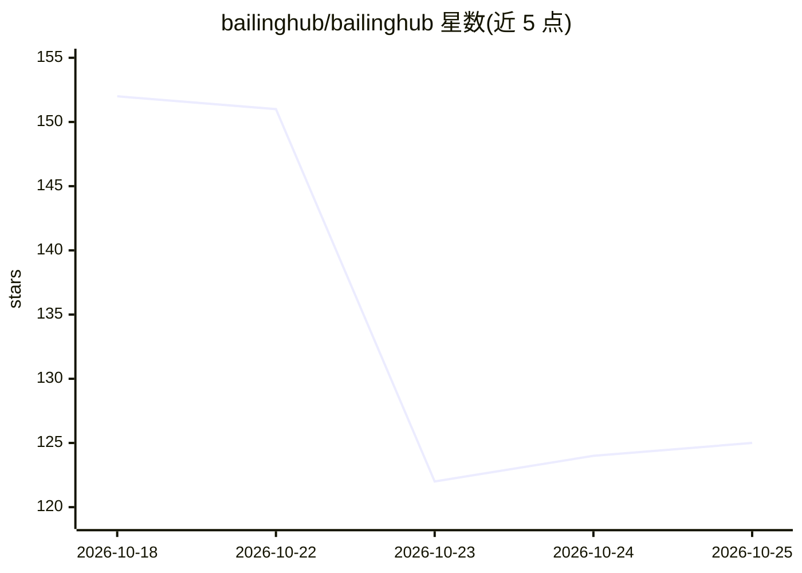

# bailinghub/bailinghub

⭐ 125 · TypeScript · Apache-2.0 · 推送 2026-10-22 · [GitHub](https://github.com/bailinghub/bailinghub) · [官网](https://www.bailinghub.com) · 组织维护 · 中文 README

**让 Agent 通过对话安全操作商城/SaaS/CRM/ERP 后台的自托管中枢**

面向已有业务系统的开源 Agent 执行中枢：业务系统通过 OpenAPI/SDK/ACC 契约声明开放能力，用户从网页聊天窗、本地智能体或 Dify/n8n/MCP 入口用自然语言完成查订单、改资料、建工单、发起审批等操作。中枢负责身份绑定（短票据/浏览器授权，不传业务密码）、能力裁剪、白名单、风险分级、限流、审批与幂等，并留存消息/任务/工具调用/审批/trace 审计；业务系统仍按原有权限做最终裁决。提供 Docker Demo（内置订单查询、退款审批等 fixture，无需真实系统或模型 Key）、docker compose 与一键安装脚本部署，服务端 Node.js/TypeScript，需 MySQL 持久化。当前处于早期公开验证阶段，不是浏览器 RPA，业务系统需提供可调用接口。

## 筛选速览

| 维度 | 判定 | 备注 |
|---|---|---|
| AI 角色 | `ai-ecosystem` | LLM/agent 周边工具 |
| 许可风险 | `permissive` | Apache-2.0 |
| 部署形态 | `self-host` | docker 或自建部署 |
| 模型依赖 | — | README 未给出锁定关系 |
| 硬件要求 | — | 无带数字的原话,不猜 |
| 安装摩擦 | `low` | 无编译、无系统依赖或容器化 |
| 成熟度 | `idea` | |

## 能力要点

- 接管操作不接管权限：业务系统声明能力并保留最终授权
- 执行治理链路：白名单/风险分级/审批/幂等/不确定结果冻结
- 全程审计：任务、工具调用、审批、trace 写入中枢独立状态库
- 三种入口（网页聊天/本地智能体/Client API）共享同一套能力与治理

## 适用场景

- 在已有商城或 CRM 后台嵌入聊天窗，让用户自然语言查订单、发起退款
- 让本地 Agent 通过浏览器授权绑定业务身份后执行后台操作
- 为 Dify/n8n/MCP 接入方复用统一的业务身份、审批与审计记录

## 场景标签

`AI 助手` `Agent 框架` · 领域:Agent 开发

## 证据(README 行号)

> L7: 把“查订单、改资料、创建工单、发起审批”等你主动开放的后台能力接进来，用户就能从网页聊天窗、本地智能体或 Dify / n8n / MCP 等入口，用自然语言完成真实业务操作。BailingHub 负责身份绑定、能力范围、风险控制和
> L78: 4. **BailingHub 执行治理**：白名单、风险等级、限流、确认、审批和幂等规则在调用前生效。
> L87: - **MCP**解决工具发现与调用协议；BailingHub 补上业务侧的能力裁剪、身份、风险、审批、限流和审计。两者可以配合使用。

## 星数曲线

2026-10-18 152 → 2026-10-25 125（-27）

---
*卡片 v1 · prompt 1.4 · 生成 2026-10-22 · 置信度 high · 依据 README sha `d3c53fc15b1a` · [字段定义](../../DATASET.md)*
