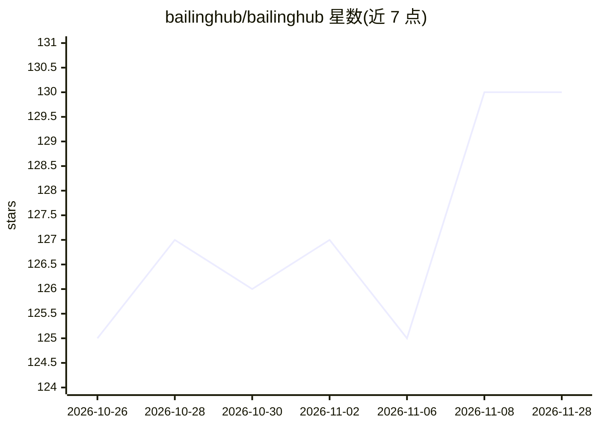

# bailinghub/bailinghub

⭐ 130 · TypeScript · Apache-2.0 · 推送 2026-11-23 · [GitHub](https://github.com/bailinghub/bailinghub) · [官网](https://www.bailinghub.com) · 组织维护 · 中文 README

**让 Agent 通过对话安全操作你现有商城/SaaS/CRM/ERP 后台的中枢**

BailingHub（百灵中枢）是面向现有业务系统的开源 Agent 业务执行中枢：业务系统通过 OpenAPI/SDK/ACC 契约声明可调用工具，用户从网页聊天窗、本地智能体或 Dify/n8n/MCP 等入口用自然语言发起查订单、改资料、退款式等真实业务操作。中枢负责身份绑定（短票据/浏览器授权，不传密码）、能力裁剪、白名单、风险分级、限流、审批与全程审计；业务系统按原有权限做最终裁决，中枢不读取业务数据库。服务端 Node.js/TypeScript，控制台 Vue，Apache-2.0，单组织部署。

## 筛选速览

| 维度 | 判定 | 备注 |
|---|---|---|
| AI 角色 | `ai-ecosystem` | LLM/agent 周边工具 |
| 许可风险 | `permissive` | Apache-2.0 |
| 部署形态 | `self-host` | docker 或自建部署 |
| 模型依赖 | — | README 未给出锁定关系 |
| 硬件要求 | — | 无带数字的原话,不猜 |
| 安装摩擦 | `low` | 无编译、无系统依赖或容器化 |
| 成熟度 | `idea` | |

## 能力要点

- ACC（Agent Capability Contract）契约把 OpenAPI/SDK 编译成统一工具定义
- 高风险写操作先冻结调用快照进入审批，批准后只执行获批的那次请求
- 三种入口（网页聊天、本地智能体、API/平台）共用同一套业务能力与审计
- 对接入方要求业务接口可验签，不做浏览器 RPA

## 适用场景

- 给商城/SaaS 后台增加一个能查数据、办业务的 AI 助手
- 退款、删除等高风险操作由 Agent 发起并走人工审批
- 已用 MCP/Dify/n8n 的团队复用统一业务身份与审计记录
- 需要自托管且不愿把业务密码直接交给模型的团队

## 场景标签

`工作流自动化` `AI 助手` · 领域:效率与自动化

## 证据(README 行号)

> L5: **BailingHub（百灵中枢）**是一个面向现有商城、SaaS、CRM、ERP 和内部管理系统的开源 Agent 业务执行中枢。
> L7: 把“查订单、改资料、创建工单、发起审批”等你主动开放的后台能力接进来，用户就能从网页聊天窗、本地智能体或 Dify / n8n / MCP 等入口，用自然语言完成真实业务操作。BailingHub 负责身份绑定、能力范围、风险控制和
> L78: 4. **BailingHub 执行治理**：白名单、风险等级、限流、确认、审批和幂等规则在调用前生效。

## 星数曲线

2026-10-26 125 → 2026-11-28 130（+5）

---
*卡片 v1 · prompt 1.4 · 生成 2026-11-28 · 置信度 high · 依据 README sha `d9a8c617c56e` · [字段定义](../../DATASET.md)*
