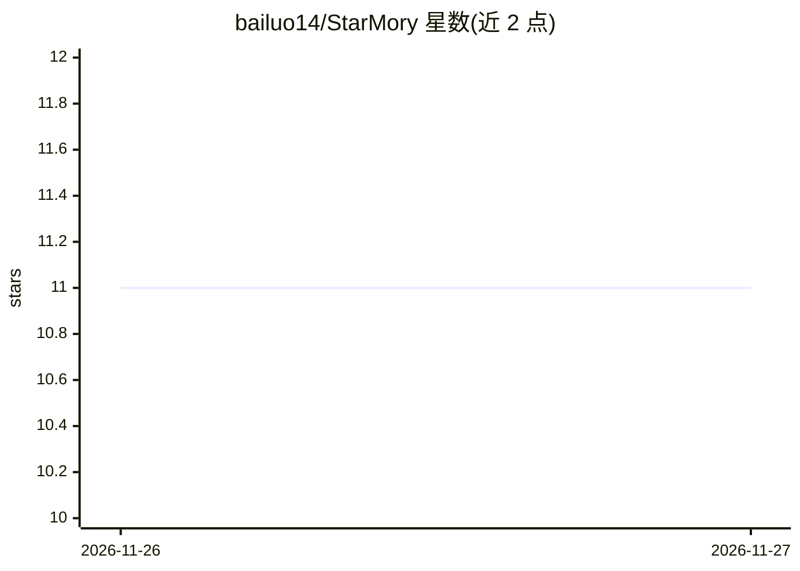

# bailuo14/StarMory

⭐ 11 · Rust · GPL-3.0 · 推送 2026-11-24 · [GitHub](https://github.com/bailuo14/StarMory) · 个人维护 · 中文 README

**带长期记忆的 Windows 本地大模型客户端，面向角色扮演陪伴**

基于 Tauri + llama.cpp 的 Windows 桌面客户端，运行本地 GGUF 模型，定位为陪伴型/角色扮演型对话工具。核心机制是角色记忆系统：跨会话长期记忆星图、自动记忆增量提取与对账、剧情卡、跨会话续章与断字回复。首次启动按显卡自动匹配 CUDA/Vulkan/CPU 引擎（llama.cpp 官方构建，经魔搭分发），内置 llama-server 可作为 OpenAI 兼容后端供 SillyTavern 等前端调用，并支持接入 OpenAI 兼容云端 API、MCP 工具与离线语音朗读。解压即用，GPL v3 许可，不附带模型文件。

## 筛选速览

| 维度 | 判定 | 备注 |
|---|---|---|
| AI 角色 | `ai-native` | 本体是模型或模型工具 |
| 许可风险 | `viral` | GPL-3.0 |
| 部署形态 | `desktop` | 安装包/桌面程序 |
| 模型依赖 | local-ok | 支持本地模型 |
| 硬件要求 | — | 无带数字的原话,不猜 |
| 安装摩擦 | `medium` | 含编译或系统依赖之一 |
| 成熟度 | — | 结构信号不足 |

## 能力要点

- 长期记忆星图与自动记忆（v1.10：空闲直写、对账、星系视图）
- 首次启动按显卡自动配置引擎：N 卡 CUDA / AMD·Intel Vulkan / CPU 保底
- 内置 llama-server 提供 OpenAI 兼容接口，可给 SillyTavern 等外部前端当后端
- 支持 MCP 工具（stdio 与 Streamable HTTP）与离线语音朗读（Piper / Edge TTS）

## 适用场景

- 在本地离线运行 GGUF 模型进行角色扮演聊天
- 让 AI 角色跨会话记住剧情与个人信息
- 把内置 llama-server 当作酒馆等前端的本地后端
- 迁移 LM Studio / Ollama 的聊天记录继续使用

## 场景标签

`推理引擎` `聊天机器人` · 领域:对话与助手

## 证据(README 行号)

> L5: **会记得你的本地大模型客户端 —— 全 N 卡可用，离线、轻量、开箱能聊**
> L42: 断字回复（像真人一样一条一条发消息）——这是为"陪伴型/角色扮演型"用户做的记忆系统，
> L117: 程序内置的 llama-server 是标准 OpenAI 兼容服务，**可以直接给 SillyTavern（酒馆）之类的前端用**：

## 星数曲线

2026-11-26 11 → 2026-11-27 11（+0）

---
*卡片 v1 · prompt 1.4 · 生成 2026-11-26 · 置信度 high · 依据 README sha `cf927d39f430` · [字段定义](../../DATASET.md)*
