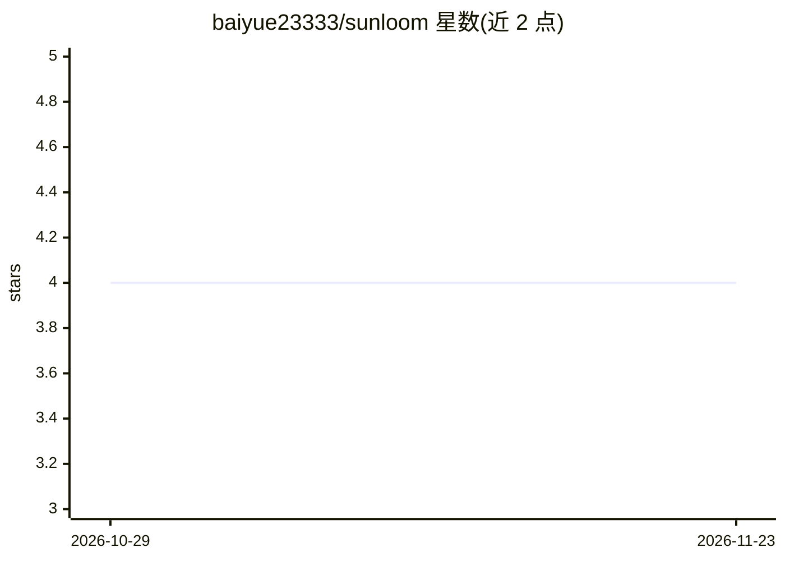

# baiyue23333/sunloom

⭐ 4 · Python · MIT · 推送 2026-11-21 · [GitHub](https://github.com/baiyue23333/sunloom) · 个人维护 · 中文 README

**面向出图创作者的积木式提示词工作站，经 ComfyUI 出图**

本地部署的出图与工作流管理站，由 FastAPI 站台、ComfyUI 后端、规则编排引擎与 SQLite 组成。将提示词拆为机位、打光、服装等 670 条结构化 @宏 积木，支持权重调节、冲突检测与一键修正；提供常规直出与合作重映两种模式（重映含身体裁切重绘、脸手精修）；自动记录每张图的配方与参数供复现。不含模型与 LoRA 权重，需自行准备 ComfyUI、Anima 三件套模型文件。

## 筛选速览

| 维度 | 判定 | 备注 |
|---|---|---|
| AI 角色 | `ai-native` | 本体是模型或模型工具 |
| 许可风险 | `permissive` | MIT |
| 部署形态 | `library` | 以包/库形式分发 |
| 模型依赖 | — | README 未给出锁定关系 |
| 硬件要求 | — | 无带数字的原话,不猜 |
| 安装摩擦 | `medium` | 含编译或系统依赖之一 |
| 成熟度 | — | 结构信号不足 |

## 能力要点

- 670 条结构化 @宏 积木，支持性别过滤与权重包装
- 双出图模式：常规直出与合作重映三段式管线（裁切重绘/脸手精修）
- 显存三档分级调度，CUDA OOM 自动清模重试
- 每张图自动记录配方（积木、种子、步数、CFG、LoRA）

## 适用场景

- 拼装可复用积木快速组合提示词批量出图
- 大场景人物构图的分阶段精修重绘
- 低显存环境下分级调度生成图片
- 追溯并复现已生成图片的完整参数配方

## 场景标签

`提示工程` `图像生成` · 领域:Agent 开发

## 证据(README 行号)

> L11: **SUNLOOM** 是一套围绕 **Anima（Qwen-Image）** 底模深度定制的本地出图与工作流管理工作站，由 **FastAPI 站台（`127.0.0.1:8770`）+ ComfyUI（`127.0.0.1:8
> L19: |**双出图模式**|**常规直出模式**（全图一次 T2I，`denoise=1.0`，画师自由度最高）与 **合作（重映）模式**（三页签独立工作台：`环境 → 人物 → 出图`）|

## 星数曲线

2026-10-29 4 → 2026-11-23 4（+0）

---
*卡片 v1 · prompt 1.4 · 生成 2026-11-21 · 置信度 high · 依据 README sha `3426c30f072e` · [字段定义](../../DATASET.md)*
