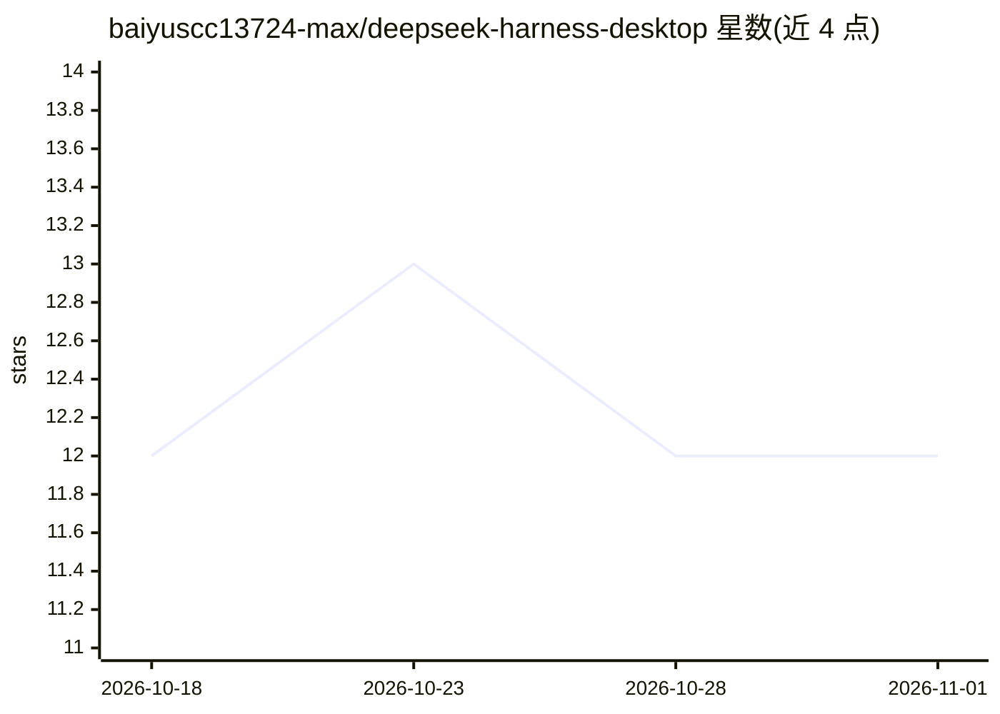

# baiyuscc13724-max/deepseek-harness-desktop

⭐ 12 · JavaScript · MIT · 推送 2026-10-14 · [GitHub](https://github.com/baiyuscc13724-max/deepseek-harness-desktop) · [官网](https://github.com/baiyuscc13724-max/deepseek-harness-desktop/releases/latest) · 个人维护 · 中文 README

**DeepSeek Harness 的中文 Windows/macOS 桌面客户端，含桌宠与插件市场**

社区维护的 Electron 桌面壳，把官方 DeepSeek Harness Web 工作台包装为 Windows/macOS 桌面应用（Windows 为正式支持平台，macOS 为源码预览）。会话、工作区与智能体核心直接采用官方 Harness，桌面壳只负责窗口、运行时启动、安装更新与桌面增强：女仆鲸桌宠、主题皮肤、DSH 插件市场、主模型与子代理路由、集成终端、Computer Use、Android/iOS 扫码配对移动工作台（WebRTC P2P 与 WSS/443 加密后备）。更新经 Ed25519 签名清单与 SHA-256 校验，移除桌面插件后官方工作台仍可独立运行。非 DeepSeek 官方应用。

## 筛选速览

| 维度 | 判定 | 备注 |
|---|---|---|
| AI 角色 | `ai-ecosystem` | LLM/agent 周边工具 |
| 许可风险 | `permissive` | MIT |
| 部署形态 | `library` | 以包/库形式分发 |
| 模型依赖 | — | README 未给出锁定关系 |
| 硬件要求 | — | 无带数字的原话,不猜 |
| 安装摩擦 | `low` | 无编译、无系统依赖或容器化 |
| 成熟度 | `idea` | |

## 能力要点

- 以桌面壳形式运行官方 DeepSeek Harness 工作台，不维护私有核心分支
- 女仆鲸桌宠、主题皮肤、DSH 插件与受管 Skills 市场
- 主模型/子代理路由与实验性协作团队功能
- Android/iOS 扫码配对，WebRTC P2P 直连与端到端加密 WSS/443 后备
- Ed25519 签名与 SHA-256 校验的安装包/增量更新

## 适用场景

- 在 Windows 桌面上以原生窗口使用 DeepSeek Harness 工作台
- 通过手机扫码远程查看与操作桌面会话
- 用桌宠、主题与插件自定义使用体验

## 场景标签

`AI 助手` · 领域:对话与助手

## 证据(README 行号)

> L86: Harness Desktop 负责 Windows/macOS 窗口、运行时启动、安装、更新和桌面增强。会话、工作区、权限和智能体核心能力直接采用官方 DeepSeek Harness，不维护私有核心分支。新增桌面能力只进入 E
> L122: Harness Desktop is a community-maintained Windows and macOS client for the official DeepSeek Harness Web UI. The c

## 星数曲线

2026-10-18 12 → 2026-11-01 12（+0）

---
*卡片 v1 · prompt 1.4 · 生成 2026-11-01 · 置信度 high · 依据 README sha `35113e76380a` · [字段定义](../../DATASET.md)*
