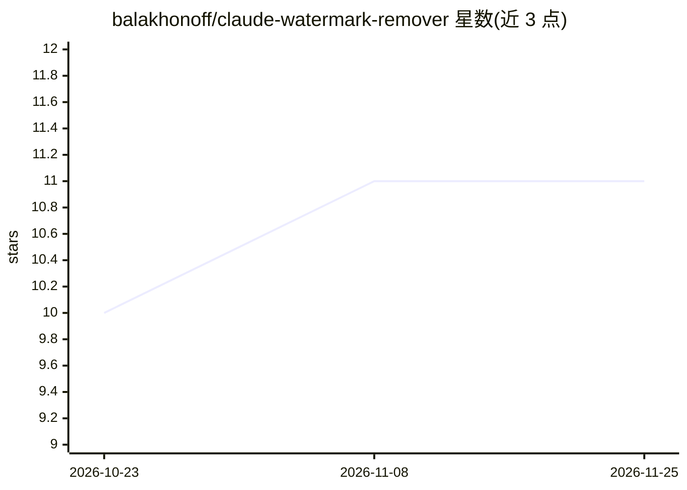

# balakhonoff/claude-watermark-remover

⭐ 11 · TypeScript · MIT · 推送 2026-10-21 · [GitHub](https://github.com/balakhonoff/claude-watermark-remover) · [官网](https://painintheagent.com/tools/ai-text-watermark-remover/) · 个人维护

**用自有 OpenRouter key 去除 AI 文本统计水印的 MCP 服务器**

开源 MCP 服务器，通过改写措辞（保留含义、结构与格式）移除 ChatGPT、Claude、Gemini 文本中的统计水印。流程为：遮蔽链接、邮箱、引用等固定片段，发送改写指令给模型，本地无模型校验（占位符完整、长度 80–125%、五词序列替换率≥80%），再还原遮蔽部分并返回 novelty_percent。本地运行，仅以用户自己的 key 调用 OpenRouter 免费模型；免费模型响应慢（1–3.5 分钟）、可用性不保证，文本需 750 字符以上数字才可靠。

## 筛选速览

| 维度 | 判定 | 备注 |
|---|---|---|
| AI 角色 | `ai-native` | 本体是模型或模型工具 |
| 许可风险 | `permissive` | MIT |
| 部署形态 | `library` | 以包/库形式分发 |
| 模型依赖 | locked-api |  |
| 硬件要求 | — | 无带数字的原话,不猜 |
| 安装摩擦 | `low` | 无编译、无系统依赖或容器化 |
| 成熟度 | — | 结构信号不足 |

## 能力要点

- 四步流程：遮蔽→模型改写→本地校验→还原，本地校验无需模型调用
- 支持 Claude Desktop（.mcpb）、Claude Code、Codex、Cursor 等 MCP 客户端及命令行
- 可经 WATERMARK_MODEL 自定义任意 :free 模型及多模型顺序回退
- 提供 remove_watermark 与 get_configuration 两个 MCP 工具，返回替换率、布局保持等指标

## 适用场景

- 改写 AI 生成文本以绕过 SynthID 类统计水印检测
- 在自己的 MCP 客户端里以免费模型零成本处理文本
- 保持术语、数字与排版不变的深度改写

## 场景标签

`AI 写作` · 领域:内容生成

## 证据(README 行号)

> L3: An open-source MCP server that removes statistical text watermarks, the kind ChatGPT, Claude and Gemini put into
> L24: 2. Sends the masked text to the model with one instruction set: rewrite every sentence with a different constructio
> L101: |`remove_watermark`|`text` (100–10,000 characters) and optional `style_guidance` (your writing-style rules, applie

## 星数曲线

2026-10-23 10 → 2026-11-25 11（+1）

---
*卡片 v1 · prompt 1.4 · 生成 2026-11-18 · 置信度 high · 依据 README sha `19c09729c5ba` · [字段定义](../../DATASET.md)*
