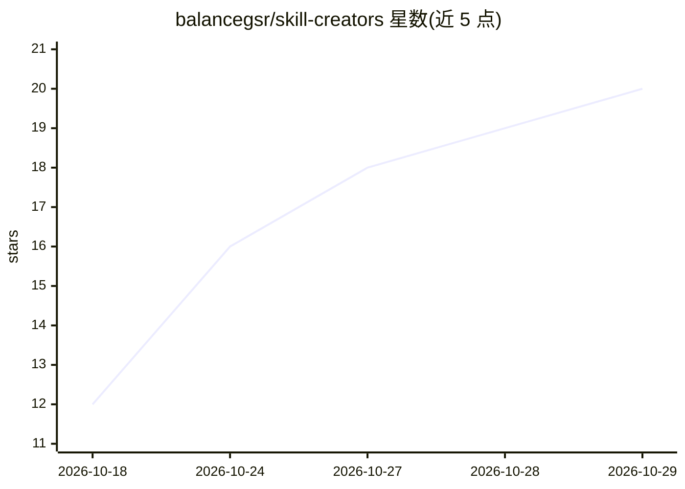

# balancegsr/skill-creators

⭐ 20 · MIT · 推送 2026-03-30 · [GitHub](https://github.com/balancegsr/skill-creators) · 个人维护 · 中文 README

**生成定制化项目级 AI Skill 的 Creator 工具集**

MethodCraft 系列：三个 Skill Creator（learning/design/build），各自通过 2-3 轮结构化对话收集项目需求，生成定制化的 SKILL.md 与 references/，产物可安装到 agent 中长期引导学习、设计、构建项目全流程。所有生成物内置基于纯文件读写的 memory 机制，支持自动保存产出、跨对话恢复状态与上下文读取优先级调整，不依赖平台记忆 API。每个 Creator 提供轻量/完整两种模式；安装方式在各自子目录 README 中说明。

## 筛选速览

| 维度 | 判定 | 备注 |
|---|---|---|
| AI 角色 | `ai-ecosystem` | LLM/agent 周边工具 |
| 许可风险 | `permissive` | MIT |
| 部署形态 | `None` |  |
| 模型依赖 | — | README 未给出锁定关系 |
| 硬件要求 | — | 无带数字的原话,不猜 |
| 安装摩擦 | `low` | 无编译、无系统依赖或容器化 |
| 成熟度 | — | 结构信号不足 |

## 能力要点

- 2-3 轮对话生成定制 SKILL.md（+references/）
- 生成物内置纯文件读写实现的 memory 系统（自动保存、跨对话恢复、读取优先级）
- learning/design/build 三个 Creator 覆盖学→设计→做链路
- 轻量/完整两种模式适配不同项目规模

## 适用场景

- 让 agent 在长期项目中持续引导从启动到结项
- 跨对话保持项目进度与决策记录
- 按不同项目类型生成学习/设计/构建的定制 Skill

## 场景标签

`提示工程` `Agent 记忆` · 领域:Agent 开发

## 证据(README 行号)

> L5: 一组 Skill Creator（生成器），根据你的项目需求生成定制化的项目级 Skill。
> L7: 每个 Creator 运行一次，通过 2-3 轮对话了解你的需求后，生成一个完整的 SKILL.md（+ references/）。生成物安装后，能在你的实际项目中持续引导从启动到结项的全过程。
> L55: 主要为 OpenClaw 设计，同时兼容能操作本地文件系统的 AI Agent 产品（Claude Code、WorkBuddy、CodeBuddy、Antigravity 等）。所有指令使用描述性语言，不依赖特定平台 API。

## 星数曲线

2026-10-18 12 → 2026-10-29 20（+8）

---
*卡片 v1 · prompt 1.4 · 生成 2026-10-28 · 置信度 high · 依据 README sha `8ff98ae63ca0` · [字段定义](../../DATASET.md)*
