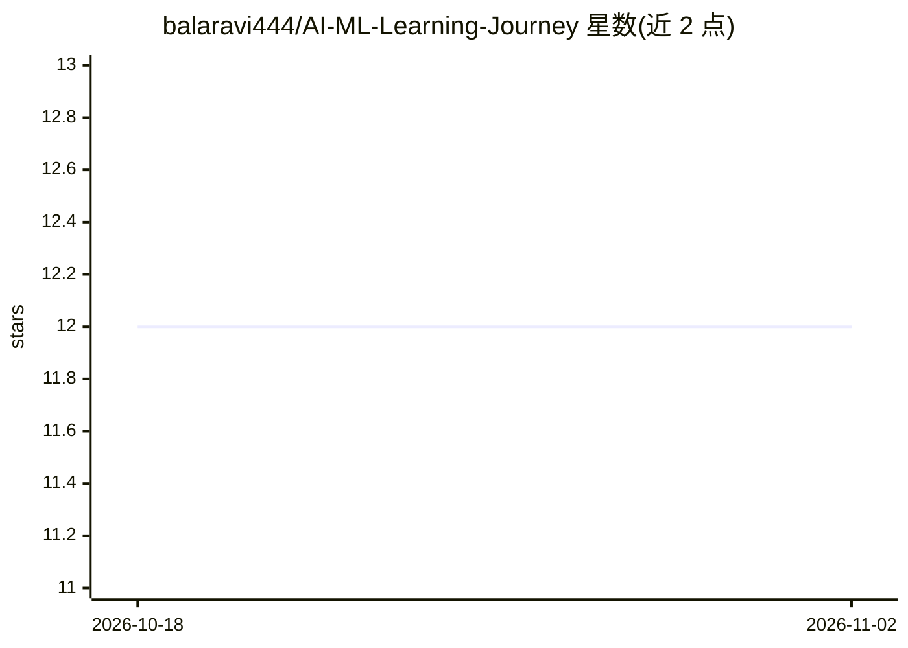

# balaravi444/AI-ML-Learning-Journey

⭐ 12 · Python · MIT · 推送 2026-10-05 · [GitHub](https://github.com/balaravi444/AI-ML-Learning-Journey) · 个人维护

**个人 90 天 AI/ML 学习旅程记录：笔记、代码与项目路线图**

个人学习仓库：记录从 Python 基础、DSA、数据科学、机器学习到深度学习的 90 天逐日进度，每天附笔记与代码条目。包含多个实践项目（ArthAI 个人财务顾问、印度就业市场分析器、皮肤疾病检测器等），部分标注为已上线。Phase 6 规划企业级 AI 产品（AI Engineering Copilot、ReqMind AI），仅列出技术栈与设想。仓库以 README 进度表和项目目录组织，未提供本产品安装命令。

## 筛选速览

| 维度 | 判定 | 备注 |
|---|---|---|
| AI 角色 | `ai-knowledge` | 知识聚合/清单类 |
| 许可风险 | `permissive` | MIT |
| 部署形态 | `None` |  |
| 模型依赖 | — | README 未给出锁定关系 |
| 硬件要求 | — | 无带数字的原话,不猜 |
| 安装摩擦 | `low` | 无编译、无系统依赖或容器化 |
| 成熟度 | — | 结构信号不足 |

## 能力要点

- 90 天 6 阶段学习路线（Python/DSA/数据科学/ML/深度学习）与逐日进度表
- 多个实践项目：ArthAI 财务顾问（FastAPI + Gemini LLM）、就业市场薪资 ML 预测器、RAG Capstone 等
- Phase 6 规划两个企业 AI 产品方案（代码库问答 Copilot、需求智能分析平台）

## 适用场景

- 参考 AI/ML 学习路线与逐日计划安排
- 查看从基础到 RAG/Agent 的项目式学习结构
- 了解面向印度场景的 AI 应用项目构思

## 场景标签

`教程课程` · 领域:学习与行业

## 证据(README 行号)

> L40: |🐍 **Phase 1**|Python Foundations|Day 01–20|✅ Complete|
> L51: |Day|Topic|Notes|Code|

## 星数曲线

2026-10-18 12 → 2026-11-02 12（+0）

---
*卡片 v1 · prompt 1.4 · 生成 2026-11-01 · 置信度 mid · 依据 README sha `2d885e164255` · [字段定义](../../DATASET.md)*
