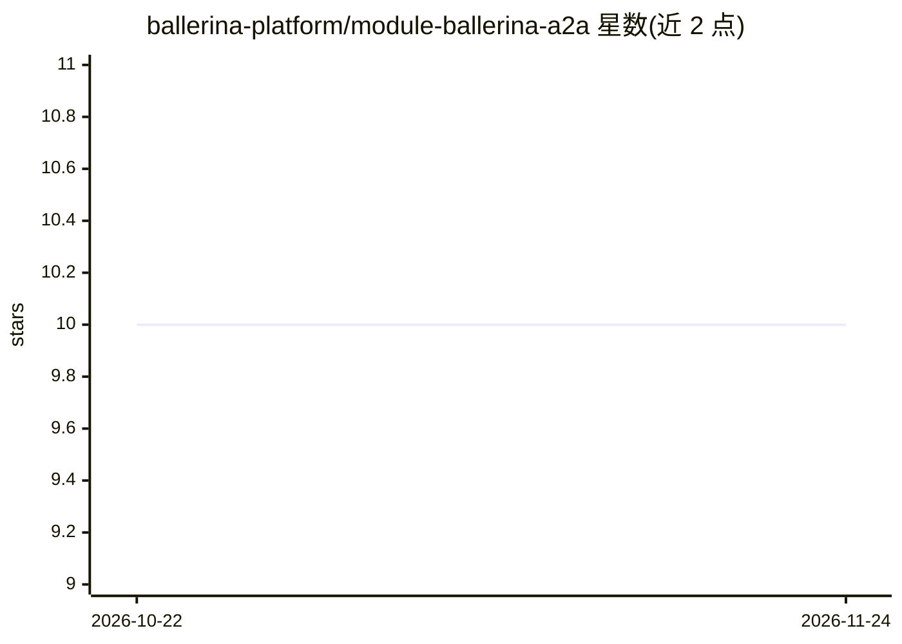

# ballerina-platform/module-ballerina-a2a

⭐ 10 · Ballerina · Apache-2.0 · 推送 2026-11-16 · [GitHub](https://github.com/ballerina-platform/module-ballerina-a2a) · 组织维护

**Ballerina 的 A2A 协议客户端与服务器实现库**

为 Ballerina 语言提供 Agent2Agent (A2A) 协议 v1.0 的 client 与 listener 实现，覆盖 HTTP+JSON binding。机制上，agent 通过发布 Agent Card 描述技能、传输方式与认证要求，客户端读取该卡片并按声明的方式调用与跟踪委托任务；本模块同时实现调用方与服务方两侧。构建需 JDK 25 及带读包权限的 GitHub token（构建依赖 GitHub Packages 解析 Ballerina 发行版）。

## 筛选速览

| 维度 | 判定 | 备注 |
|---|---|---|
| AI 角色 | `ai-ecosystem` | LLM/agent 周边工具 |
| 许可风险 | `permissive` | Apache-2.0 |
| 部署形态 | `None` |  |
| 模型依赖 | — | README 未给出锁定关系 |
| 硬件要求 | — | 无带数字的原话,不猜 |
| 安装摩擦 | `medium` | 含编译或系统依赖之一 |
| 成熟度 | — | 结构信号不足 |

## 能力要点

- A2A 协议 v1.0 的 client 与 listener 双侧实现
- 基于 HTTP+JSON binding 的 agent 间通信
- Agent Card 机制描述技能、传输与认证要求

## 适用场景

- 让 Ballerina 服务作为 A2A agent 被其他 agent 发现和调用
- 从 Ballerina 代码中调用其他 agent 并跟踪委托任务
- 构建符合 A2A 规范的 agent 间通信组件

## 场景标签

`Agent 框架` · 领域:Agent 开发

## 证据(README 行号)

> L12: This module provides a Ballerina client and server for the Agent2Agent (A2A) protocol v1.0, an open protocol for co
> L14: A2A lets an agent discover what another agent can do, delegate work to it, and follow that work as it progresses. A

## 星数曲线

2026-10-22 10 → 2026-11-24 10（+0）

---
*卡片 v1 · prompt 1.4 · 生成 2026-11-19 · 置信度 high · 依据 README sha `5bb1446754d4` · [字段定义](../../DATASET.md)*
