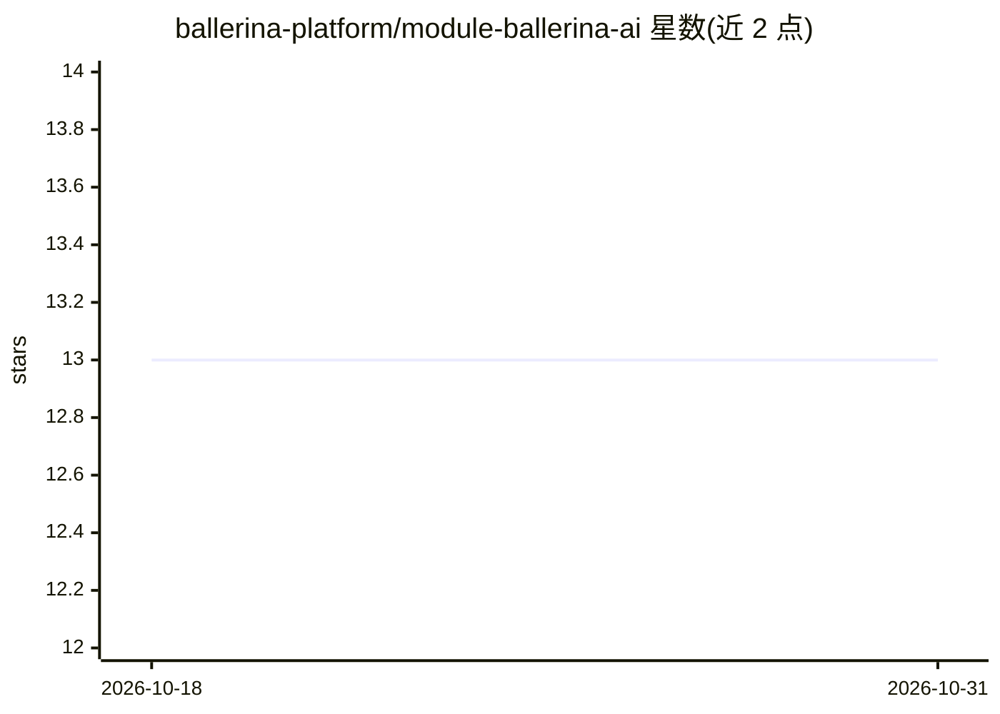

# ballerina-platform/module-ballerina-ai

⭐ 13 · Ballerina · Apache-2.0 · 推送 2026-10-29 · [GitHub](https://github.com/ballerina-platform/module-ballerina-ai) · 组织维护

**Ballerina 语言的 AI agent 构建库**

Ballerina 平台下的 ai 模块源码仓库，提供用 Ballerina 语言构建基于 LLM 的 AI agent 的 API。Agent 可处理自然语言输入、生成回复并按指令决策，可用于问答、工作流自动化或与外部系统交互。仓库仅含模块源码，需 JDK 25 与 GitHub 访问令牌，通过 Gradle 构建并发布到 Ballerina Central；问题追踪与讨论在 Ballerina Library 父仓库进行。README 未列出具体模型提供方接入细节。

## 筛选速览

| 维度 | 判定 | 备注 |
|---|---|---|
| AI 角色 | `ai-ecosystem` | LLM/agent 周边工具 |
| 许可风险 | `permissive` | Apache-2.0 |
| 部署形态 | `None` |  |
| 模型依赖 | — | README 未给出锁定关系 |
| 硬件要求 | — | 无带数字的原话,不猜 |
| 安装摩擦 | `medium` | 含编译或系统依赖之一 |
| 成熟度 | — | 结构信号不足 |

## 能力要点

- 提供基于 LLM 构建 AI agent 的 Ballerina API
- agent 可处理自然语言输入、生成回复并按指令决策
- Gradle 构建并支持发布到 Ballerina Central

## 适用场景

- 用 Ballerina 语言开发 LLM 驱动的 agent
- 在 Ballerina 工作流中集成问答与自动化任务
- 作为 Ballerina 标准库的一部分被引用

## 场景标签

`Agent 框架` · 领域:Agent 开发

## 证据(README 行号)

> L12: This module provides APIs for building AI agents using Large Language Models (LLMs).
> L14: AI agents use LLMs to process natural language inputs, generate responses, and make decisions based on given instru

## 星数曲线

2026-10-18 13 → 2026-10-31 13（+0）

---
*卡片 v1 · prompt 1.4 · 生成 2026-10-31 · 置信度 mid · 依据 README sha `b1d3e8ed3474` · [字段定义](../../DATASET.md)*
