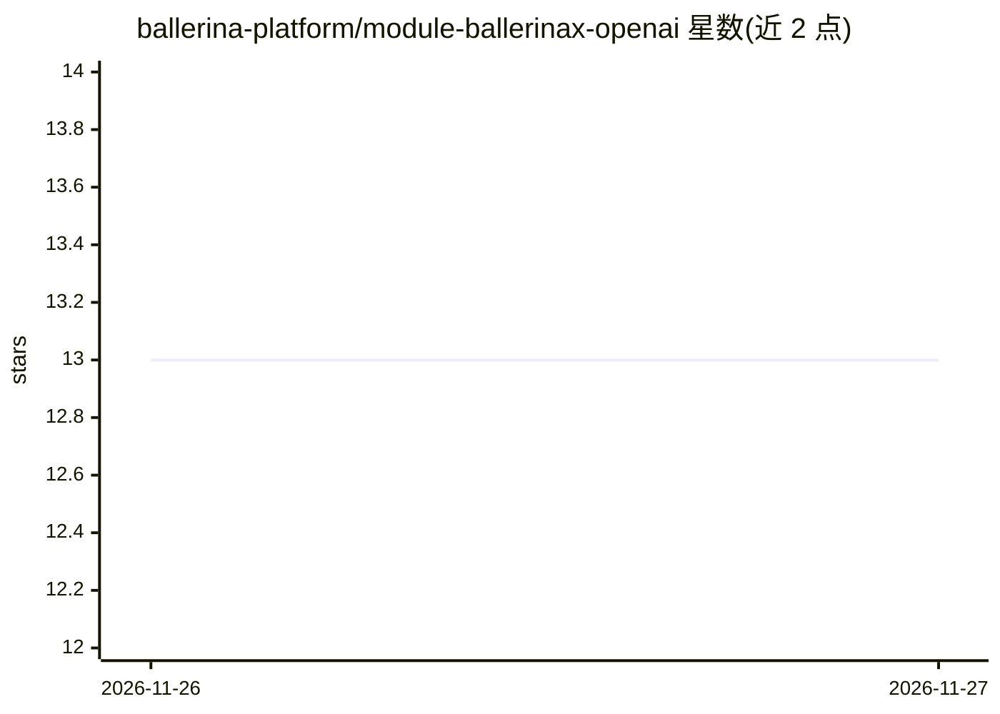

# ballerina-platform/module-ballerinax-openai

⭐ 13 · Ballerina · Apache-2.0 · 推送 2026-10-07 · [GitHub](https://github.com/ballerina-platform/module-ballerinax-openai) · [官网](https://ballerina.io) · 组织维护

**为 Ballerina 开发者提供 OpenAI API 接入连接器**

Ballerina 语言的 OpenAI 连接器包（ballerinax/openai），封装 OpenAI API v2.3.0 端点，使 Ballerina 应用能调用 GPT、Whisper、DALL·E 等模型。使用需自备 OpenAI 账号与 API key，通过 Config.toml 配置凭证，导入模块并实例化 Client 后即可调用 Assistant 等操作。README 提供 Financial Assistant 与 Marketing Image Generator 两个示例场景，源码构建需 JDK 21、Ballerina Swan Lake 并用 Gradle 执行。

## 筛选速览

| 维度 | 判定 | 备注 |
|---|---|---|
| AI 角色 | `ai-ecosystem` | LLM/agent 周边工具 |
| 许可风险 | `permissive` | Apache-2.0 |
| 部署形态 | `None` |  |
| 模型依赖 | — | README 未给出锁定关系 |
| 硬件要求 | — | 无带数字的原话,不猜 |
| 安装摩擦 | `medium` | 含编译或系统依赖之一 |
| 成熟度 | — | 结构信号不足 |

## 能力要点

- 封装 OpenAI API v2.3.0 端点，支持 GPT/Whisper/DALL·E 等模型接入
- 通过 Config.toml 配置 API key 凭证
- 提供 Assistant 创建等连接器操作与两个示例场景
- Gradle 构建支持测试、远程调试与发布到 Ballerina Central

## 适用场景

- 在 Ballerina 应用中调用 GPT 构建财务助手类对话功能
- 用 DALL·E 根据控制台输入描述生成营销图片
- 在 Ballerina 项目中接入 Whisper 等模型服务

## 场景标签

 · 领域:开发工具/API 接入

## 证据(README 行号)

> L10: The `ballerinax/openai` package offers APIs to easily connect and interact with OpenAI API v2.3.0 endpoints, enabli
> L47: To use the `OpenAI` connector in your Ballerina application, update the `.bal` file as follows:

## 星数曲线

2026-11-26 13 → 2026-11-27 13（+0）

---
*卡片 v1 · prompt 1.4 · 生成 2026-11-26 · 置信度 high · 依据 README sha `f423beb6cf75` · [字段定义](../../DATASET.md)*
