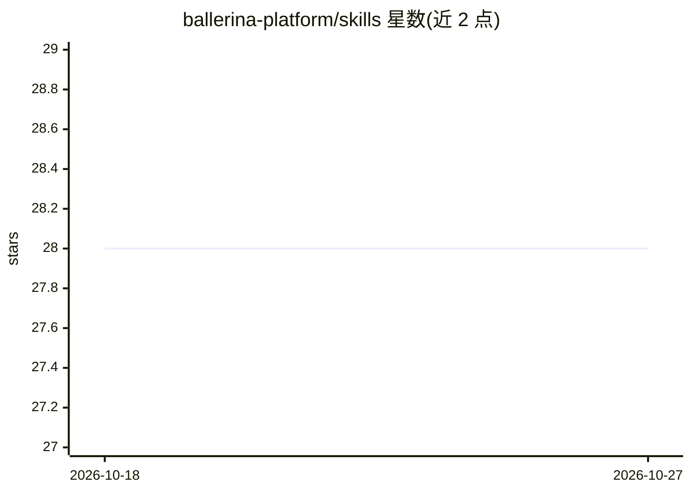

# ballerina-platform/skills

⭐ 28 · JavaScript · Apache-2.0 · 推送 2026-10-12 · [GitHub](https://github.com/ballerina-platform/skills) · 组织维护

**面向 AI 编程助手的 Ballerina 语言技能与插件集**

为 Ballerina 开发者提供的 agent 技能与插件包：包含 `.bal` 文件的语言服务器代码智能、编写集成与服务的 `ballerina` 技能、从 Ballerina Central 发现库的 MCP 服务器与 discovery agent，以及构建/运行/测试项目的激活钩子。以 Claude Code 与 GitHub Copilot 插件市场安装为主渠道，MCP 服务器预构建；也可经 Open Agent Skills CLI（npx skills add）面向 Codex、Cursor、Gemini CLI 等安装，但该渠道仅含技能本体。前置要求 Ballerina 2201.12.0+ 与 Node.js 18+。

## 筛选速览

| 维度 | 判定 | 备注 |
|---|---|---|
| AI 角色 | `ai-ecosystem` | LLM/agent 周边工具 |
| 许可风险 | `permissive` | Apache-2.0 |
| 部署形态 | `library` | 以包/库形式分发 |
| 模型依赖 | — | README 未给出锁定关系 |
| 硬件要求 | — | 无带数字的原话,不猜 |
| 安装摩擦 | `low` | 无编译、无系统依赖或容器化 |
| 成熟度 | — | 结构信号不足 |

## 能力要点

- 提供 `.bal` 语言服务器代码智能与 `ballerina` 技能
- 从 Ballerina Central 发现并添加库的 MCP 服务器（预构建，无需 npm install）
- 支持 Claude Code、GitHub Copilot 插件市场及 Open Agent Skills CLI 多渠道安装
- 技能可按请求自动激活或经 `/ballerina` 直接调用

## 适用场景

- 在 Claude Code / Copilot 中编写、构建、运行 Ballerina 项目
- 让 AI 助手从 Ballerina Central 查找并引入所需库
- 诊断与修正 `.bal` 文件代码

## 场景标签

`提示工程` · 领域:Agent 开发

## 证据(README 行号)

> L3: Agent skills and plugins for Ballerina developers — language-server code intelligence for `.bal` files, and an AI co
> L21: Restart the session to activate the language server, the `ballerina` skill, the `library` discovery agent, and the 

## 星数曲线

2026-10-18 28 → 2026-10-27 28（+0）

---
*卡片 v1 · prompt 1.4 · 生成 2026-10-26 · 置信度 high · 依据 README sha `b199f0b32919` · [字段定义](../../DATASET.md)*
