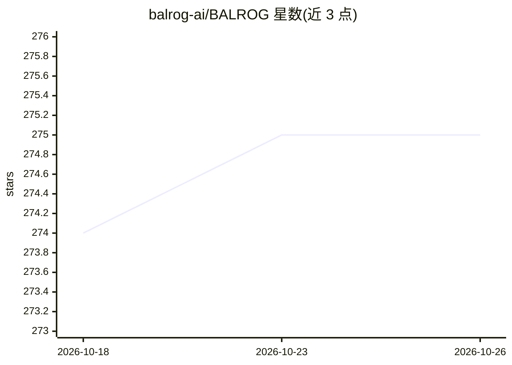

# balrog-ai/BALROG

⭐ 275 · Python · MIT · 推送 2026-04-09 · [GitHub](https://github.com/balrog-ai/BALROG) · [官网](https://balrogai.com) · 组织维护

**评测 LLM/VLM 在游戏环境中 agent 推理能力的基准**

BALROG 是一个基于强化学习环境（游戏）的评测基准，衡量 LLM 与视觉-语言模型在长时程交互任务中的 agent 能力。提供对语言与视觉语言模型的评测支持，内置 OpenAI、Anthropic、Google Gemini 的 API 客户端，也可通过本地 vLLM 服务运行模型。支持自定义 agent、新环境与新模型的接入。安装建议使用 conda（Python 3.10），并提供 Docker 镜像；Mac 平台需预装 wget。附论文（arXiv 2411.13543）与在线排行榜，MIT 许可。

## 筛选速览

| 维度 | 判定 | 备注 |
|---|---|---|
| AI 角色 | `ai-ecosystem` | LLM/agent 周边工具 |
| 许可风险 | `permissive` | MIT |
| 部署形态 | `library` | 以包/库形式分发 |
| 模型依赖 | local-ok | 支持本地模型 |
| 硬件要求 | — | 无带数字的原话,不猜 |
| 安装摩擦 | `low` | 无编译、无系统依赖或容器化 |
| 成熟度 | — | 结构信号不足 |

## 能力要点

- 基于强化学习游戏环境的长时程交互任务评测
- 同时支持语言模型与视觉语言模型
- 内置 OpenAI/Anthropic/Gemini API 客户端与 vLLM 本地运行支持
- 支持自定义 agent、新环境与新模型接入

## 适用场景

- 评测自有 LLM/VLM 的 agent 与推理能力并对比排行榜
- 研究长时程交互任务中的模型表现
- 在游戏环境中开发并测试自定义 agent

## 场景标签

`模型评测` · 领域:评测与运维

## 证据(README 行号)

> L7: BALROG is a novel benchmark evaluating agentic LLM and VLM capabilities on long-horizon interactive tasks using rein
> L13: - Integration with popular AI APIs and local deployment

## 星数曲线

2026-10-18 274 → 2026-10-26 275（+1）

---
*卡片 v1 · prompt 1.4 · 生成 2026-10-22 · 置信度 mid · 依据 README sha `29e05be788e1` · [字段定义](../../DATASET.md)*
