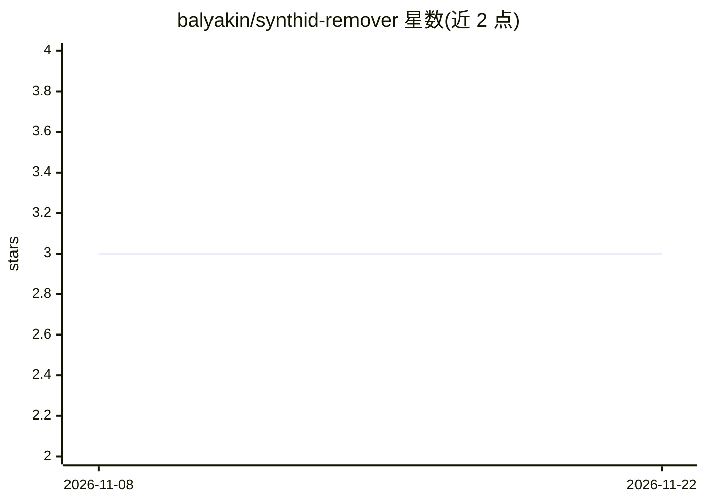

# balyakin/synthid-remover

⭐ 3 · Python · MIT · 推送 2026-10-13 · [GitHub](https://github.com/balyakin/synthid-remover) · 个人维护

**实验性 SynthID 图像水印去除的 Python 工具集**

一组针对像素级 SynthID 水印的实验性 Python 工具：主方法在两个尺度上模糊图像得到细节频带，用 donor 图像的对应频带替换并混合回部分原始频带；donor 由 Stable Diffusion 1.5 加 ControlNet Canny 重绘生成。轻量工具仅需 Pillow 与 NumPy，donor 生成与 GAN 修复需单独安装 ML 依赖。作者声明实验仅覆盖一个场景，README 记录的一次人工检测通过结果不推广到其他图像。

## 筛选速览

| 维度 | 判定 | 备注 |
|---|---|---|
| AI 角色 | `ai-enhanced` | 去掉 AI 部分产品仍成立 |
| 许可风险 | `permissive` | MIT |
| 部署形态 | `library` | 以包/库形式分发 |
| 模型依赖 | — | README 未给出锁定关系 |
| 硬件要求 | — | 无带数字的原话,不猜 |
| 安装摩擦 | `low` | 无编译、无系统依赖或容器化 |
| 成熟度 | `idea` | |

## 能力要点

- bandmix.py 频带替换与混合的主工具，支持局部对比度匹配等实验性控制
- remaster.py 用 Stable Diffusion 1.5 + ControlNet Canny/Tile 生成 donor 图像
- 附带 GAN 修复、打印-拍摄模拟、色调扰动等失败实验脚本作为对比
- provenance_check.py 调用 OpenAI Content Provenance API 检查 SynthID 结果

## 适用场景

- 对自己有权处理的图像实验去除 SynthID 像素水印
- 用 OpenAI 验证工具核查处理后图像的检测结果
- 研究不同扰动方法（GAN、半调、重绘）对水印检测的影响

## 场景标签

`图像视频处理` · 领域:感知与多模态

## 证据(README 行号)

> L10: **synthid-remover** is a collection of Python tools for experimenting with pixel-level
> L44: Where does the donor come from? `remaster.py` uses Stable Diffusion 1.5 with ControlNet Canny to repaint the scene
> L64: That is enough for `bandmix.py`, the classical processing tools, and the metrics. To generate donors or run

## 星数曲线

2026-11-08 3 → 2026-11-22 3（+0）

---
*卡片 v1 · prompt 1.4 · 生成 2026-11-22 · 置信度 high · 依据 README sha `8e11b7d82d45` · [字段定义](../../DATASET.md)*
