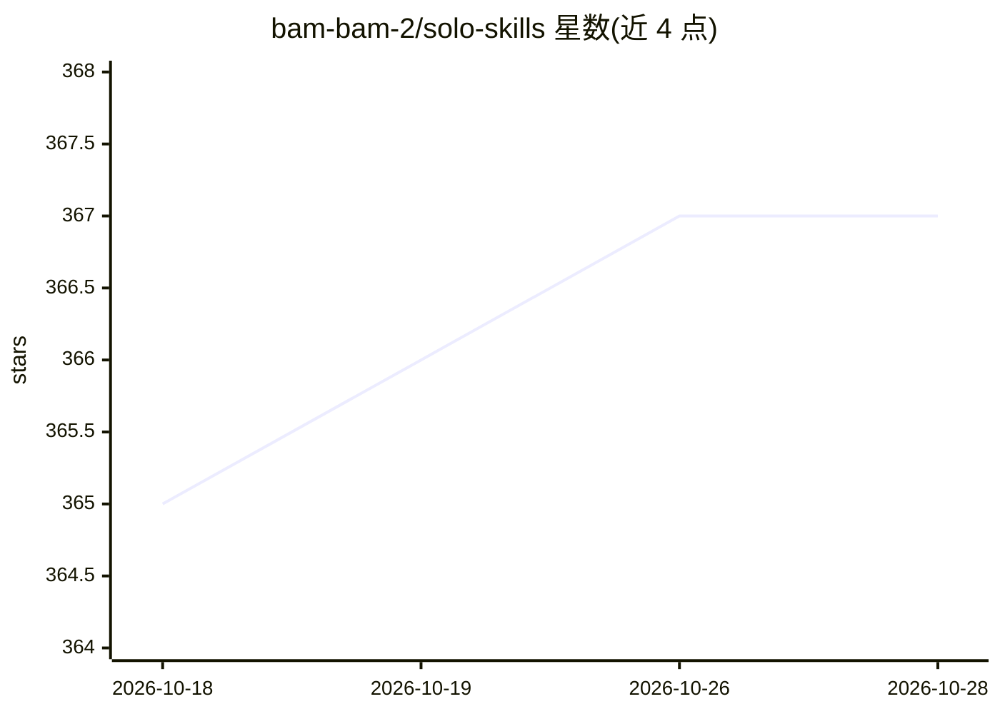

# bam-bam-2/solo-skills

⭐ 367 · Python · MIT · 推送 2026-10-22 · [GitHub](https://github.com/bam-bam-2/solo-skills) · [官网](https://get100.co.kr) · 个人维护

**韩国个体创业者的 38 个 AI agent 技能集：可复用自动化流程**

由 1 人社区 GET100 运营者公开的 agent 技能库：58 项个人自动化中挑出 38 个 SKILL.md 格式技能（含 19 个执行脚本），供读取该规格的 agent（Claude Code、Codex、OpenCode）直接调用。覆盖视频生成、电子书排版、Naver 博客、Threads 文案、会议纪要、KakaoTalk 收发、AI 文风修正等场景；22 个技能在顶部标注了系统权限与不可回滚操作。以韩语使用者与韩国本地工具（Naver、KakaoTalk、당근）为前提编写，部分技能依赖 macOS、ffmpeg、Node、Paged.js 等环境。

## 筛选速览

| 维度 | 判定 | 备注 |
|---|---|---|
| AI 角色 | `ai-knowledge` | 知识聚合/清单类 |
| 许可风险 | `permissive` | MIT |
| 部署形态 | `library` | 以包/库形式分发 |
| 模型依赖 | — | README 未给出锁定关系 |
| 硬件要求 | — | 无带数字的原话,不猜 |
| 安装摩擦 | `medium` | 含编译或系统依赖之一 |
| 成熟度 | — | 结构信号不足 |

## 能力要点

- 38 个 SKILL.md 技能 + 19 个执行脚本，兼容 Claude Code / Codex / OpenCode
- 22 个技能顶部标注所需权限、实际发信行为与可否回滚
- 技能间无依赖，可按需单独复制安装
- 多数技能附实际踩坑记录与失败路径说明

## 适用场景

- 让 Claude Code 等 agent 按既定流程完成博客写作、会议纪要整理等杂务
- 把营销视频制作、电子书排版等流程交给 agent 按步骤执行
- 参考他人验证过的 agent 技能写法来构建自己的自动化

## 场景标签

`工作流自动化` `AI 写作` `视频生成` `教程课程` · 领域:效率与自动化

## 证据(README 行号)

> L16: **그중 남이 그대로 가져다 쓸 수 있는 스킬 38개를 이 저장소에 공개합니다.**
> L28: Claude Code, Codex, OpenCode 등 SKILL.md 규격을 읽는 에이전트에서 그대로 씁니다.
> L29: 각 스킬은 **에이전트가 읽고 수행하는 작업 절차서**이고, 그중 일부에는 제가 실제로 쓰는 **실행 스크립트**가 같이 들어 있습니다. (10개 스킬 · 파일 19개)

## 星数曲线

2026-10-18 365 → 2026-10-28 367（+2）

---
*卡片 v1 · prompt 1.4 · 生成 2026-10-21 · 置信度 high · 依据 README sha `987c05d85546` · [字段定义](../../DATASET.md)*
