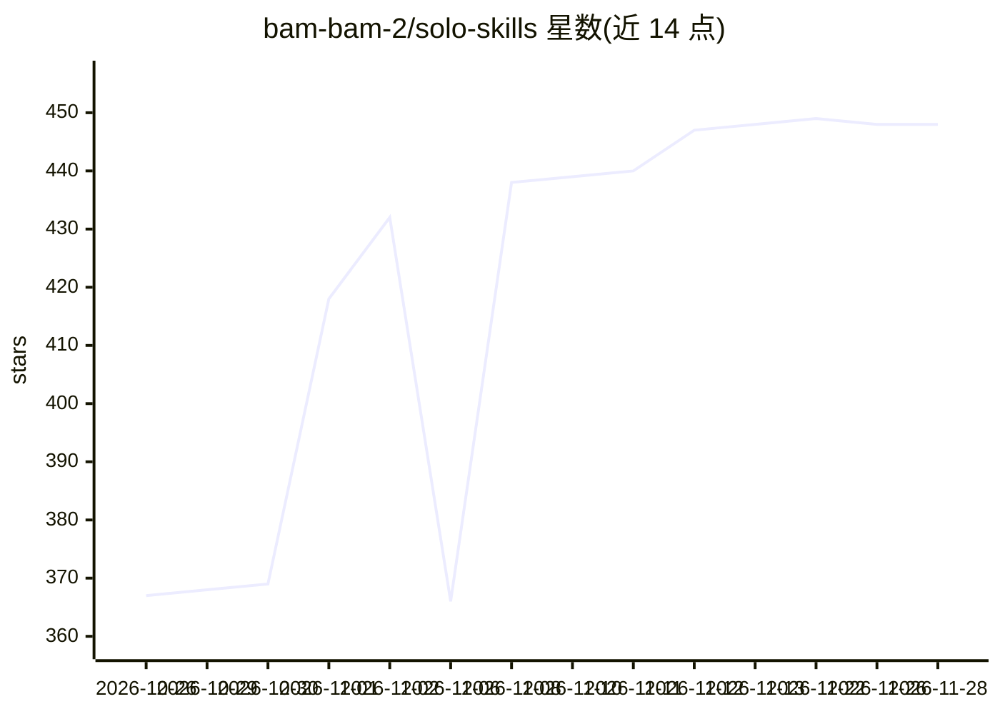

# bam-bam-2/solo-skills

⭐ 448 · Python · MIT · 推送 2026-10-22 · [GitHub](https://github.com/bam-bam-2/solo-skills) · [官网](https://get100.co.kr) · 个人维护

**面向一人创业者的 38 个 AI agent 技能集（韩文）**

由 GET100 社区运营者整理的一人创业者自动化技能库：作者自述将约 70 项单人业务流程自动化，公开其中可在他人环境复用的 38 个 SKILL.md 格式技能与 19 个执行脚本，覆盖内容制作（演示视频、电子书 PDF、字幕视频）、博客与 SNS 发布、会议纪要、邮件与消息收发、Discord 机器人运营、agent 编排等。技能按'陷阱与失败记录+步骤'结构编写，22 个含系统权限声明；兼容读取 SKILL.md 规格的 agent（Claude Code、Codex、OpenCode）。

## 筛选速览

| 维度 | 判定 | 备注 |
|---|---|---|
| AI 角色 | `ai-knowledge` | 知识聚合/清单类 |
| 许可风险 | `permissive` | MIT |
| 部署形态 | `library` | 以包/库形式分发 |
| 模型依赖 | — | README 未给出锁定关系 |
| 硬件要求 | — | 无带数字的原话,不猜 |
| 安装摩擦 | `medium` | 含编译或系统依赖之一 |
| 成熟度 | — | 结构信号不足 |

## 能力要点

- 38 个 SKILL.md 技能，其中 10 个附带 19 个执行脚本
- 按失败记录与陷阱整理步骤，22 个技能含权限与发布行为声明
- 脚本默认 dry-run（threads-reply、kakaotalk-cli）或需确认（notion-delete）
- 面向韩国工具生态：Naver 博客、KakaoTalk、Threads、당근마켓

## 适用场景

- 一人运营社区时自动化内容生产与发布流程
- 让 agent 读取转录稿生成会议纪要并写入 Notion/Discord
- 在 macOS 上通过 agent 收发 KakaoTalk/SMS/邮件
- 用已验证的技能组织 agent 分工与编排

## 场景标签

`工作流自动化` `AI 写作` `多智能体` · 领域:Agent 开发

## 证据(README 行号)

> L29: 각 스킬은 **에이전트가 읽고 수행하는 작업 절차서**이고, 그중 일부에는 제가 실제로 쓰는 **실행 스크립트**가 같이 들어 있습니다. (10개 스킬 · 파일 19개)
> L28: Claude Code, Codex, OpenCode 등 SKILL.md 규격을 읽는 에이전트에서 그대로 씁니다.

## 星数曲线

2026-10-26 367 → 2026-11-28 448（+81）

---
*卡片 v1 · prompt 1.4 · 生成 2026-11-25 · 置信度 high · 依据 README sha `ecd89f101264` · [字段定义](../../DATASET.md)*
