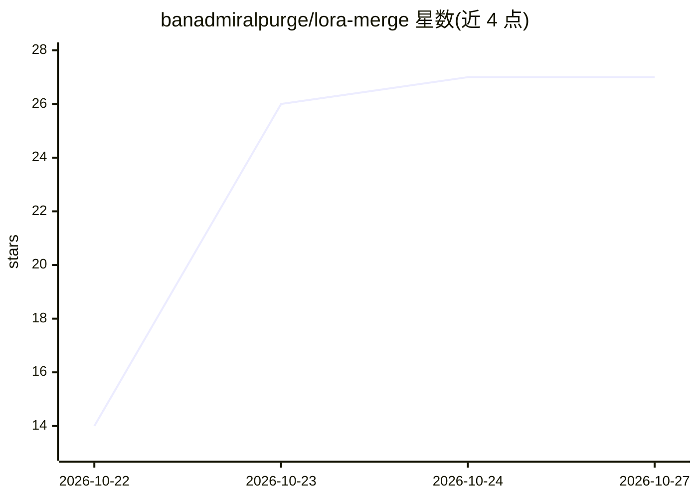

# banadmiralpurge/lora-merge

⭐ 27 · C# · MIT · 推送 2026-10-18 · [GitHub](https://github.com/banadmiralpurge/lora-merge) · 个人维护

**Windows 离线 LoRA 合并工具：多适配器加权融合并导出 safetensors**

面向 Windows 10/11 的 C#/.NET 桌面工具：将最多 5 个 LoRA 适配器按自定义权重叠加合并到基座模型，合并前对照基模校验张量数量与形状，输出保留元数据的 safetensors 文件。提供按适配器的权重滑杆、预设库（保存并在基模更新后重跑组合）、合并前副本的安全模式；GPU 可用时使用 VRAM，否则回退到内存。以 100 MB 便携 exe 分发，离线运行，无需安装；从源码构建需 .NET 8 SDK。

## 筛选速览

| 维度 | 判定 | 备注 |
|---|---|---|
| AI 角色 | `ai-ecosystem` | LLM/agent 周边工具 |
| 许可风险 | `permissive` | MIT |
| 部署形态 | `None` |  |
| 模型依赖 | — | README 未给出锁定关系 |
| 硬件要求 | — | 无带数字的原话,不猜 |
| 安装摩擦 | `medium` | 含编译或系统依赖之一 |
| 成熟度 | — | 结构信号不足 |

## 能力要点

- 最多 5 个 LoRA 适配器叠加，每个可设 0 到满的混合权重
- 写入前按基模做张量数量与形状校验
- 预设库保存混合组合，基模更新后可重跑
- 100 MB 自包含便携 exe，离线运行，GPU 不可用时回退 CPU

## 适用场景

- 离线把多个 LoRA 适配器按自定义权重合并进基座模型
- 保存常用混合比例并在基模更新后重跑
- 不想配置 Python 环境或上传模型到网站时本地完成合并

## 场景标签

 · 领域:LLM/模型工具

## 证据(README 行号)

> L3: 🧬 Free, open-source LoRA merger for Windows — blend adapters into a base model at custom weights, export safetensors
> L11: - ✅ **Weight sliders per adapter** — stack up to five LoRAs and set each blend ratio from zero to full

## 星数曲线

2026-10-22 14 → 2026-10-27 27（+13）

---
*卡片 v1 · prompt 1.4 · 生成 2026-10-26 · 置信度 high · 依据 README sha `e62b2fd52525` · [字段定义](../../DATASET.md)*
