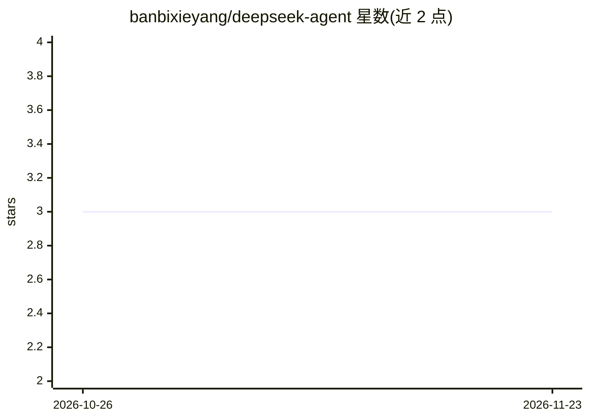

# banbixieyang/deepseek-agent

⭐ 3 · Python · NOASSERTION · 推送 2026-10-10 · [GitHub](https://github.com/banbixieyang/deepseek-agent) · 个人维护 · 中文 README

**可审批的本地 Agent 执行器：连接 DeepSeek 与本地操作**

把大模型作为“大脑”、本地机器作为“手脚”的可审批 Agent 桥接器：终端输入需求后发送给后端，接收结构化 JSON 协议块并由本地执行器执行读写文件、运行代码等步骤，结果回传循环至任务完成；全程支持人工审批与修改。提供三种后端：默认 DeepSeek 官方 API（仅依赖 requests）、可选浏览器自动化网页后端（README 标注高风险且可能违反 DeepSeek 服务条款）、OpenAI 兼容后端与本地 Ollama 后端。提供一键启动脚本与手动启动流程，MIT 许可。

## 筛选速览

| 维度 | 判定 | 备注 |
|---|---|---|
| AI 角色 | `ai-ecosystem` | LLM/agent 周边工具 |
| 许可风险 | `none` | NOASSERTION |
| 部署形态 | `desktop` | 安装包/桌面程序 |
| 模型依赖 | local-ok | 支持本地模型 |
| 硬件要求 | — | 无带数字的原话,不猜 |
| 安装摩擦 | `low` | 无编译、无系统依赖或容器化 |
| 成熟度 | — | 结构信号不足 |

## 能力要点

- 本地执行器按 JSON 协议块机械执行步骤，发送前可修改、写入前可逐项确认
- 三种可选后端：DeepSeek API（默认）、浏览器自动化、OpenAI 兼容、本地 Ollama
- API Key 只从环境变量或配置文件读取，日志仅记录前 4 位
- 文件操作限制在工作区内，越界被拒绝

## 适用场景

- 在本地让大模型代为执行文件读写与代码运行任务
- 学习 Agent 协议块与执行循环的设计方式
- 需要人工审批每个写入操作的低风险自动化场景

## 场景标签

`Agent 框架` · 领域:Agent 开发

## 证据(README 行号)

> L15: # ds-agent · 可审批的本地 Agent 执行器
> L17: 把大模型当“大脑”、本地当“手脚”的可审批 Agent 桥接器。**默认走 DeepSeek 官方 API**，可选网页自动化后端（高风险）。
> L32: |`api`（DeepSeek 官方 API）|✅ 是|仅 `requests`|低，遵守官方 ToS|

## 星数曲线

2026-10-26 3 → 2026-11-23 3（+0）

---
*卡片 v1 · prompt 1.4 · 生成 2026-11-22 · 置信度 high · 依据 README sha `435a4d18e28e` · [字段定义](../../DATASET.md)*
