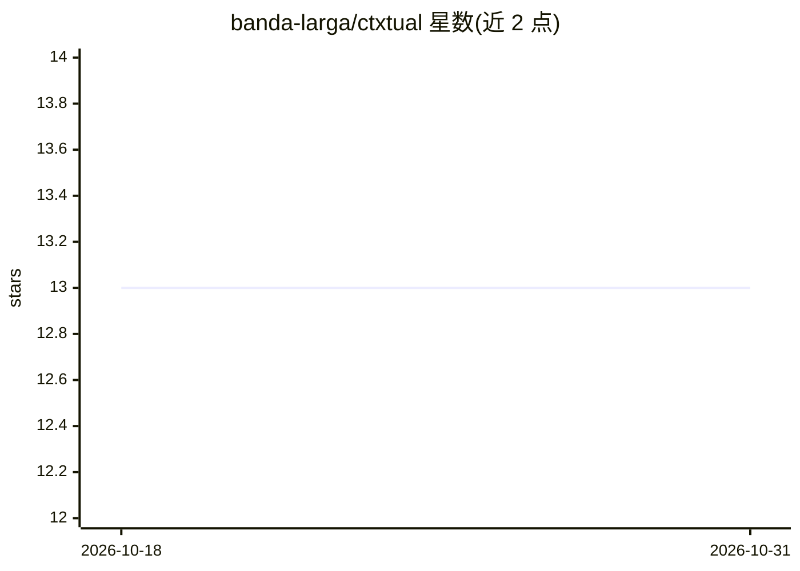

# banda-larga/ctxtual

⭐ 13 · Python · MIT · 推送 2026-10-22 · [GitHub](https://github.com/banda-larga/ctxtual) · [官网](https://pypi.org/project/ctxtual/) · 个人维护

**把大体积工具结果移出上下文窗口的 MCP 包装器与 Python 库**

面向 AI agent 开发者与 MCP 客户端用户：当工具返回上万行或数百 KB 数据时，ctxtual 将结果存储起来，仅向模型返回含预览、字段与体积的短通知，并附加 result_search/result_read/result_query/result_list 四个工具供模型检索、过滤、聚合与分页。可一行命令包装现有 MCP 服务器（支持 Claude Desktop、Cursor、VS Code、Codex、Windsurf、Gemini 等客户端，含备份与卸载），也可作为零依赖的 Python 库嵌入自建 agent 循环，提供 producer/consumer、内置工具工厂、流水线（含默认禁用的 $regex 防护）与输出上限机制。限制：仅浏览器端客户端需托管包装器。

## 筛选速览

| 维度 | 判定 | 备注 |
|---|---|---|
| AI 角色 | `ai-ecosystem` | LLM/agent 周边工具 |
| 许可风险 | `permissive` | MIT |
| 部署形态 | `library` | 以包/库形式分发 |
| 模型依赖 | — | README 未给出锁定关系 |
| 硬件要求 | — | 无带数字的原话,不猜 |
| 安装摩擦 | `low` | 无编译、无系统依赖或容器化 |
| 成熟度 | — | 结构信号不足 |

## 能力要点

- 一行命令包装任意 MCP 客户端的现有服务器，含备份与 uninstall 还原
- 大结果存储后返回短通知，附加搜索/过滤/聚合/分页四个工具
- 零依赖 Python 库形式：producer/consumer、内置工具工厂与流水线步骤
- 所有探索工具有输出上限，$regex 默认禁用并可启用带防护

## 适用场景

- MCP 客户端中工具返回超大结果导致上下文溢出或被截断
- 自建 agent 循环中让模型按需查询而非整块读取大数据
- 在 FastMCP 服务器上以中间件形式对超阈值结果做卸载

## 场景标签

`Agent 记忆` · 领域:Agent 开发

## 证据(README 行号)

> L26: - **With any MCP server, no code:** `ctxtual install <client>` wraps the
> L28: - **As a Python library** for your own agent tools (zero dependencies).
> L149: ctxtual is a library, not a framework: it doesn't own your agent loop or your

## 星数曲线

2026-10-18 13 → 2026-10-31 13（+0）

---
*卡片 v1 · prompt 1.4 · 生成 2026-10-31 · 置信度 mid · 依据 README sha `63d636de1497` · [字段定义](../../DATASET.md)*
