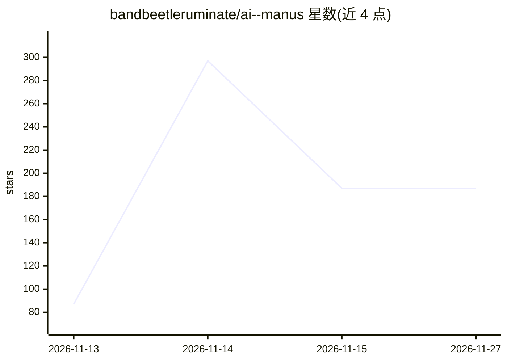

# bandbeetleruminate/ai--manus

⭐ 187 · Apache-2.0 · 推送 2026-11-15 · [GitHub](https://github.com/bandbeetleruminate/ai--manus) · 个人维护

**面向日常任务的自主 AI Agent：自行执行代码与控制浏览器**

按 README 自述，Manus 是一个自主运行的通用 AI Agent，可在用户指示下自行编写并执行脚本、控制浏览器完成网页导航、表单填写与信息收集等跨代码/浏览器的多步骤任务，定位为个人助手，用于学习研究、家庭项目与轻量办公场景。README 提供了最低/推荐硬件规格（双核 CPU、4GB/8GB 内存）与上手步骤说明，但未给出任何可验证的安装命令、源码结构或 API 接入方式，描述以功能宣传为主，实施细节缺失。

## 筛选速览

| 维度 | 判定 | 备注 |
|---|---|---|
| AI 角色 | `ai-native` | 本体是模型或模型工具 |
| 许可风险 | `permissive` | Apache-2.0 |
| 部署形态 | `None` |  |
| 模型依赖 | — | README 未给出锁定关系 |
| 硬件要求 | — | 无带数字的原话,不猜 |
| 安装摩擦 | `low` | 无编译、无系统依赖或容器化 |
| 成熟度 | — | 结构信号不足 |

## 能力要点

- 自主代码执行：agent 自行编写并运行脚本完成任务
- 浏览器控制：导航网页、填写表单、采集信息
- 代码与浏览器在同一任务流中衔接（脚本与网页操作可互相接续）

## 适用场景

- 让学生整理研究资料、跑小脚本
- 让远程工作者从多个网页收集数据
- 把重复性的小任务委托给后台 agent

## 场景标签

`AI 助手` `浏览器自动化` · 领域:效率与自动化

## 证据(README 行号)

> L18: Manus is an autonomous AI agent designed to run code and control a browser on your behalf. Instead of acting like a
> L10: - **Autonomous Code Execution:** Manus AI agent runs code on its own to complete tasks, so you can focus on decisio

## 星数曲线

2026-11-13 87 → 2026-11-27 187（+100）

---
*卡片 v1 · prompt 1.4 · 生成 2026-11-17 · 置信度 low · 依据 README sha `0f78ee3a5dd2` · [字段定义](../../DATASET.md)*
