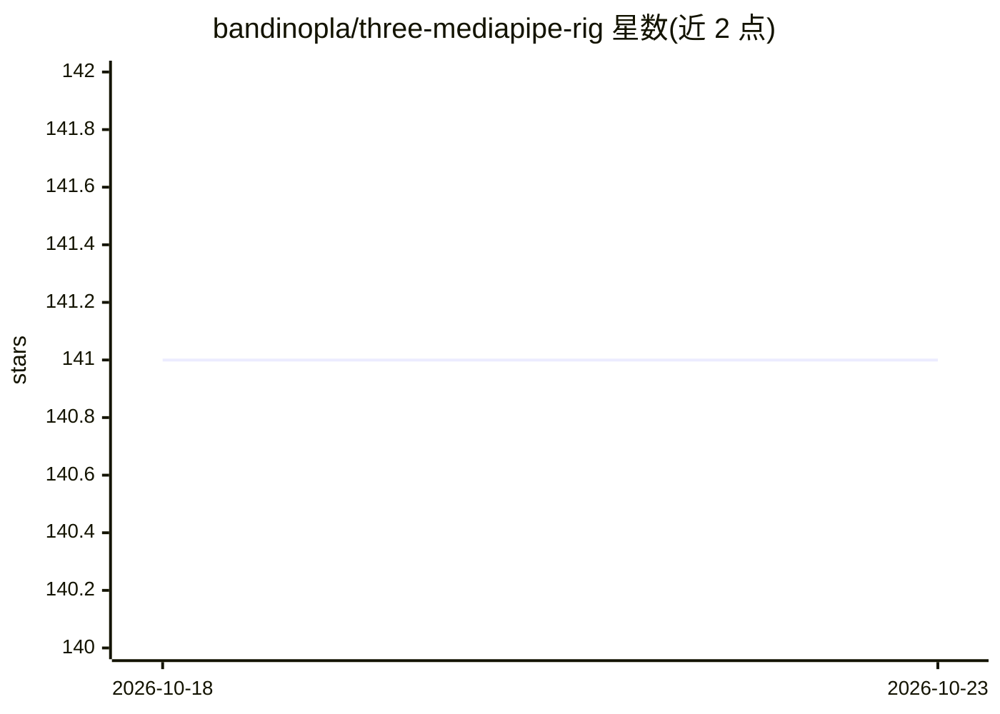

# bandinopla/three-mediapipe-rig

⭐ 141 · TypeScript · 推送 2026-04-10 · [GitHub](https://github.com/bandinopla/three-mediapipe-rig) · [官网](https://bandinopla.github.io/three-mediapipe-rig/) · 个人维护

**用摄像头驱动 Three.js 骨骼的 MediaPipe 动作捕捉模块**

npm 安装的 Three.js 模块，封装 Google MediaPipe 的 face/body/hands 三个视觉模型，把摄像头或视频中的实时动作以角度驱动方式映射到任意尺寸的 Three.js 骨骼 rig 上。提供自动骨骼绑定（可自定义骨骼名映射）、面部 blendshape 表情与视频贴脸几何、多角色绑定、录制导出 .glb 动画，以及用预录视频/单帧做调试。需安装 three 与 mediapipe 作为 peer 依赖；同时运行 3 个模型会有 FPS 下降。

## 筛选速览

| 维度 | 判定 | 备注 |
|---|---|---|
| AI 角色 | `ai-native` | 本体是模型或模型工具 |
| 许可风险 | `none` | — |
| 部署形态 | `library` | 以包/库形式分发 |
| 模型依赖 | — | README 未给出锁定关系 |
| 硬件要求 | — | 无带数字的原话,不猜 |
| 安装摩擦 | `low` | 无编译、无系统依赖或容器化 |
| 成熟度 | — | 结构信号不足 |

## 能力要点

- 角度驱动映射，适配任意尺寸骨骼
- 身体/手部（含单指骨骼）/面部 blendshape 同时追踪
- 录制动作捕捉并导出 .glb 动画
- 可用预录视频或静态图片替代摄像头调试

## 适用场景

- 用摄像头实时驱动我的 3D 角色做动画
- 把摄像头面部数据用于面部网格变形与贴图
- 无需动捕设备录制角色动作并导出 .glb

## 场景标签

 · 领域:3D/动作捕捉

## 证据(README 行号)

> L5: Integrate Google MediaPipe's **webcam motion tracking** with Three.js skeletal rigs.
> L7: The motion from the webcam will be applied to a skeleton. Angle based so it works with any size skeleton.
> L25: - **Full-body pose tracking** — shoulders, arms, hips, legs, and head

## 星数曲线

2026-10-18 141 → 2026-10-23 141（+0）

---
*卡片 v1 · prompt 1.4 · 生成 2026-10-22 · 置信度 high · 依据 README sha `b1bea67aa251` · [字段定义](../../DATASET.md)*
