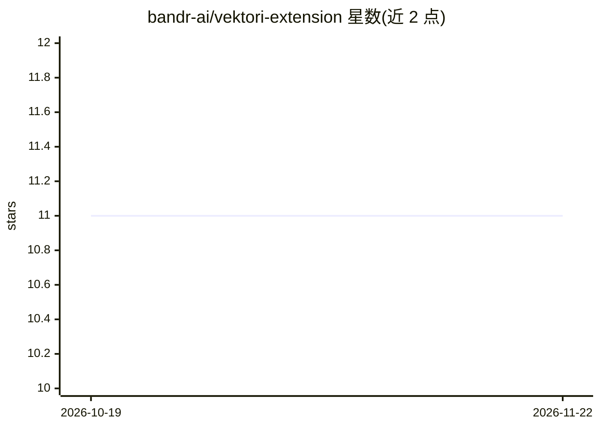

# bandr-ai/vektori-extension

⭐ 11 · JavaScript · MIT · 推送 2026-01-17 · [GitHub](https://github.com/bandr-ai/vektori-extension) · [官网](https://vektori.cloud) · 组织维护

**跨 6 个 AI 聊天平台保存并语义检索对话的 Chrome 扩展**

一款浏览器扩展，自动保存用户在 ChatGPT、Claude、Gemini、Perplexity、DeepSeek、Grok 六个平台的对话，支持跨会话的语义搜索，并在新对话中注入相关历史记忆作为上下文。声明数据归属用户且需登录认证。可通过 Chrome 商店安装，也支持开发者模式加载源码；开发基于 TypeScript，依赖 npm 安装并构建后台 service worker、popup、sidepanel 等组件。

## 筛选速览

| 维度 | 判定 | 备注 |
|---|---|---|
| AI 角色 | `ai-enhanced` | 去掉 AI 部分产品仍成立 |
| 许可风险 | `permissive` | MIT |
| 部署形态 | `library` | 以包/库形式分发 |
| 模型依赖 | — | README 未给出锁定关系 |
| 硬件要求 | — | 无带数字的原话,不猜 |
| 安装摩擦 | `low` | 无编译、无系统依赖或容器化 |
| 成熟度 | — | 结构信号不足 |

## 能力要点

- 自动保存 6 个 AI 平台的对话
- 跨全部已存对话的语义搜索
- 上下文注入：将相关历史记忆带入新对话
- 需认证登录，数据声明归用户所有

## 适用场景

- 把在不同 AI 平台的问答统一存档并检索
- 新开对话时自动带上相关的历史上下文
- 开发模式下加载源码自行调试扩展

## 场景标签

`RAG` `语义搜索` · 领域:知识与检索

## 证据(README 行号)

> L3: Your personal AI memory across all chat platforms. Save and search conversations from ChatGPT, Claude, Gemini, Perpl
> L9: - Context injection to bring relevant memories into new chats
> L12: ## Installation

## 星数曲线

2026-10-19 11 → 2026-11-22 11（+0）

---
*卡片 v1 · prompt 1.4 · 生成 2026-11-18 · 置信度 mid · 依据 README sha `b9f17c955d59` · [字段定义](../../DATASET.md)*
