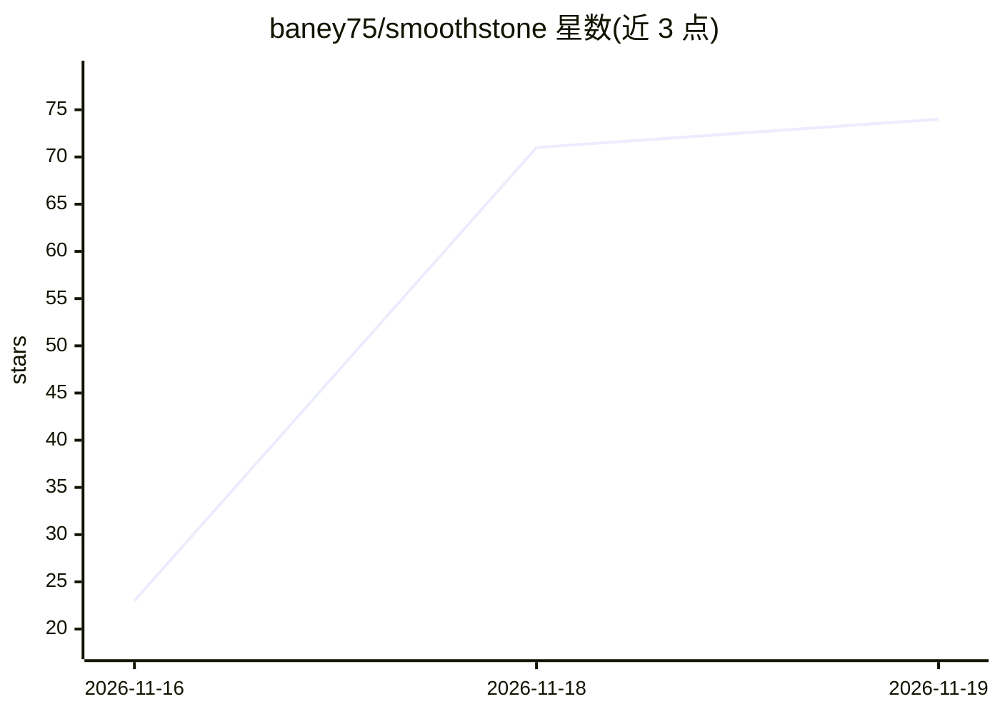

# baney75/smoothstone

⭐ 74 · Python · MIT · 推送 2026-11-18 · [GitHub](https://github.com/baney75/smoothstone) · 个人维护

**让小型本地模型生成可3D打印零件的技能与CLI工具**

smoothstone 是一个面向 agent 的技能包和命令行工具：小模型（如 LFM3-1.7B）不直接编写几何代码，而是从 15 个经过测试的配方（fan_guard、vase、gridfinity_bin 等）中挑选并填入尺寸，由 stone 工具调用 OpenSCAD（Manifold 后端）构建零件并执行打印检查（水密、壁厚、悬垂等）。通过 `stone status` 每条消息末尾的下一步提示，模型在上下文压缩或丢失后仍可继续任务。支持从图片生成钥匙扣、浮雕等，通过 uv 从源码安装，需要 OpenSCAD 2026+ 与 potrace（图片功能）。

## 筛选速览

| 维度 | 判定 | 备注 |
|---|---|---|
| AI 角色 | `ai-ecosystem` | LLM/agent 周边工具 |
| 许可风险 | `permissive` | MIT |
| 部署形态 | `None` |  |
| 模型依赖 | — | README 未给出锁定关系 |
| 硬件要求 | — | 无带数字的原话,不猜 |
| 安装摩擦 | `low` | 无编译、无系统依赖或容器化 |
| 成熟度 | — | 结构信号不足 |

## 能力要点

- 模型只选配方填参数，几何代码由工具生成，避免小模型写 OpenSCAD 失败
- 打印前网格检查：水密、单件、壁厚、悬垂角度、尺寸等，失败时指出需修改的设置
- stone status 机制使模型在上下文被清空后仍能继续完成零件
- 按模型规模分 S/M/L 三档能力卡，支持 Claude Code、Codex、llama.cpp 等 agent 接入

## 适用场景

- 在本地 CPU 上用 1.7B 级小模型生成可打印的 3D 零件
- 让 Claude Code/Codex 等 agent 通过技能调用 3D 建模能力
- 从照片生成钥匙扣、饼干模、光栅浮雕等轮廓类零件

## 场景标签

 · 领域:3D 打印/CAD 工具

## 证据(README 行号)

> L5: I wanted a small model running on my own computer to make 3D printable parts that actually look good, so I tested LF
> L67: The skill is the `skill` folder. Link it where your agent looks for skills:
> L75: For a local model on llama.cpp, give it one tool named `stone` that runs a stone command line, and put `skill/tiers

## 星数曲线

2026-11-16 23 → 2026-11-19 74（+51）

---
*卡片 v1 · prompt 1.4 · 生成 2026-11-18 · 置信度 high · 依据 README sha `e5e14e4e69c1` · [字段定义](../../DATASET.md)*
