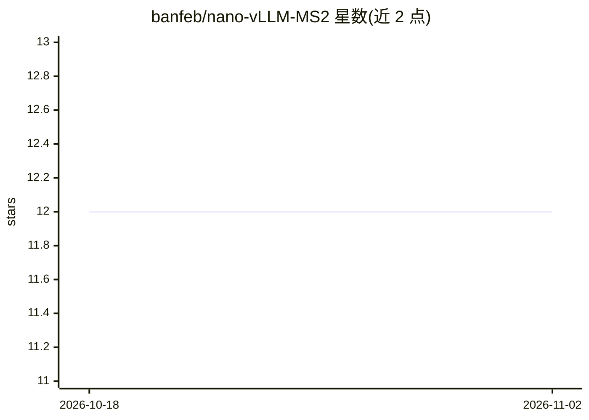

# banfeb/nano-vLLM-MS2

⭐ 12 · Python · MIT · 推送 2026-06-01 · [GitHub](https://github.com/banfeb/nano-vLLM-MS2) · 个人维护

**轻量 vLLM 实现，支持 MoE 模型与投机解码**

基于 nano-vLLM 的轻量推理引擎，扩展支持 Qwen3-MoE 模型（router top-k 专家选择与融合专家计算），并实现端到端投机解码管线（N-gram draft 提议，Numba 加速与自适应线程控制）。保留前缀缓存、张量并行、CUDA graph 等 nano-vLLM 优化。API 镜像 vLLM 接口，提供 MoE 推理与投机解码的示例脚本和基准脚本，面向本地 LLM 推理开发者。

## 筛选速览

| 维度 | 判定 | 备注 |
|---|---|---|
| AI 角色 | `ai-ecosystem` | LLM/agent 周边工具 |
| 许可风险 | `permissive` | MIT |
| 部署形态 | `library` | 以包/库形式分发 |
| 模型依赖 | — | README 未给出锁定关系 |
| 硬件要求 | — | 无带数字的原话,不猜 |
| 安装摩擦 | `medium` | 含编译或系统依赖之一 |
| 成熟度 | — | 结构信号不足 |

## 能力要点

- Qwen3-MoE 支持：router top-k 专家选择与融合专家计算
- N-gram draft 投机解码管线，Numba 加速与自适应线程控制
- 保留前缀缓存、张量并行、CUDA graph 捕获等优化
- API 镜像 vLLM 接口，附基准与示例脚本

## 适用场景

- 在轻量代码库中本地推理 Qwen3-MoE 模型
- 用 N-gram 投机解码提升生成吞吐
- 学习/研究 MoE 与投机解码的实现细节

## 场景标签

`推理引擎` · 领域:训练与推理

## 证据(README 行号)

> L3: A lightweight vLLM implementation based on nano-vLLM, enhanced with MoE model support and Speculative Decoding.
> L7: * ✅ **MoE model support** - Supports Qwen3-MoE models in the nano-vLLM inference pipeline. Included router-based top
> L8: * ✅ **Speculative Decoding pipeline** - Implements an end-to-end speculative decoding path with N-gram draft token p

## 星数曲线

2026-10-18 12 → 2026-11-02 12（+0）

---
*卡片 v1 · prompt 1.4 · 生成 2026-11-01 · 置信度 high · 依据 README sha `0ac0d6ee530c` · [字段定义](../../DATASET.md)*
