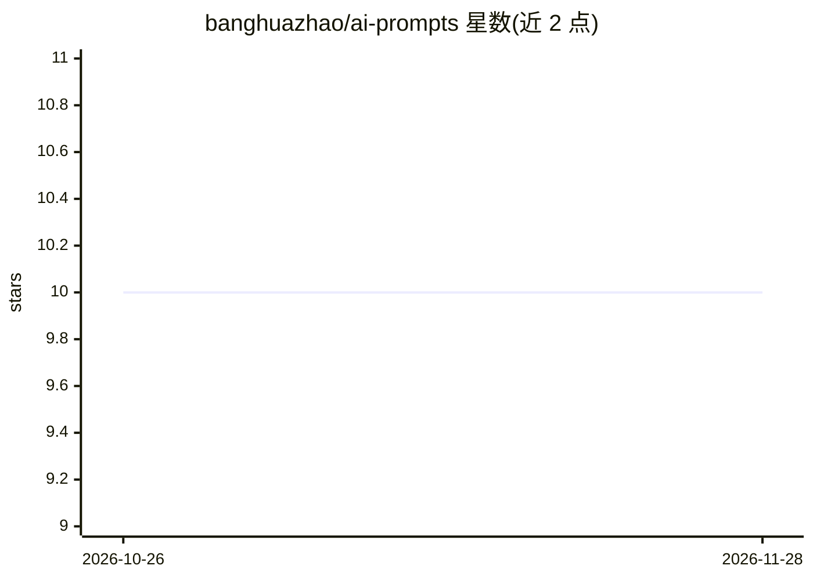

# banghuazhao/ai-prompts

⭐ 10 · Swift · MIT · 推送 2026-10-31 · [GitHub](https://github.com/banghuazhao/ai-prompts) · [官网](https://apps.apple.com/us/app/ai-prompts-ai-prompt-directory/id6748734078) · 个人维护

**管理、浏览与分享 AI 提示词的 iOS 应用**

用 Swift/SwiftUI 编写的 iOS 提示词管理应用：内置精选提示词库（含 Vibe Prompts 分区），支持收藏、分类、使用频率排序、模板填空、剪贴板/分享面板导入、JSON 备份恢复，以及通过 content/feed.json 在不更新 App 的情况下分发新提示词。AI 能力依托 Apple Intelligence 端侧模型：生成提示词草稿、按自然语言挑选提示词、在应用内直接运行提示词并流式返回结果；无 Apple Intelligence 的设备以 Markov 链离线混排库内容替代。支持快速启动到 ChatGPT、Claude 等助手，提供 Mac Catalyst 版本与繁中本地化。构建需 Xcode 与 Swift 5.9+，部署最低 iOS 17.4。

## 筛选速览

| 维度 | 判定 | 备注 |
|---|---|---|
| AI 角色 | `ai-native` | 本体是模型或模型工具 |
| 许可风险 | `permissive` | MIT |
| 部署形态 | `None` |  |
| 模型依赖 | — | README 未给出锁定关系 |
| 硬件要求 | — | 无带数字的原话,不猜 |
| 安装摩擦 | `low` | 无编译、无系统依赖或容器化 |
| 成熟度 | — | 结构信号不足 |

## 能力要点

- Apple Intelligence 端侧生成提示词与运行提示词（iOS 26，离线可用）
- 填空模板 {{topic}}、${Name: default} 实时预览并快速启动到多个 AI 助手
- content/feed.json 远端提示词源实现免更新下发新内容
- 无 Apple Intelligence 设备用 Markov 链离线混排生成提示词创意

## 适用场景

- 集中管理日常使用的提示词并按分类、收藏、使用频率检索
- 把提示词一键粘贴到 ChatGPT/Claude/Gemini 等助手运行
- 在设备端离线生成或改写提示词草稿
- 通过维护 feed.json 向所有安装端持续发布新提示词

## 场景标签

`提示工程` · 领域:Agent 开发

## 证据(README 行号)

> L3: A Swift iOS app for managing, browsing, and sharing AI prompts. Inspired by f/awesome-chatgpt-prompts, this app offe
> L10: - ✨ **Generate Prompt Ideas**: Tell Apple Intelligence what a prompt should help with (or leave it empty for a surp
> L27: - 🍎 **Run on Device with Apple Intelligence**: On iOS 26 devices with Apple Intelligence, run any prompt right in t

## 星数曲线

2026-10-26 10 → 2026-11-28 10（+0）

---
*卡片 v1 · prompt 1.4 · 生成 2026-11-19 · 置信度 high · 依据 README sha `f1275cd45ec1` · [字段定义](../../DATASET.md)*
