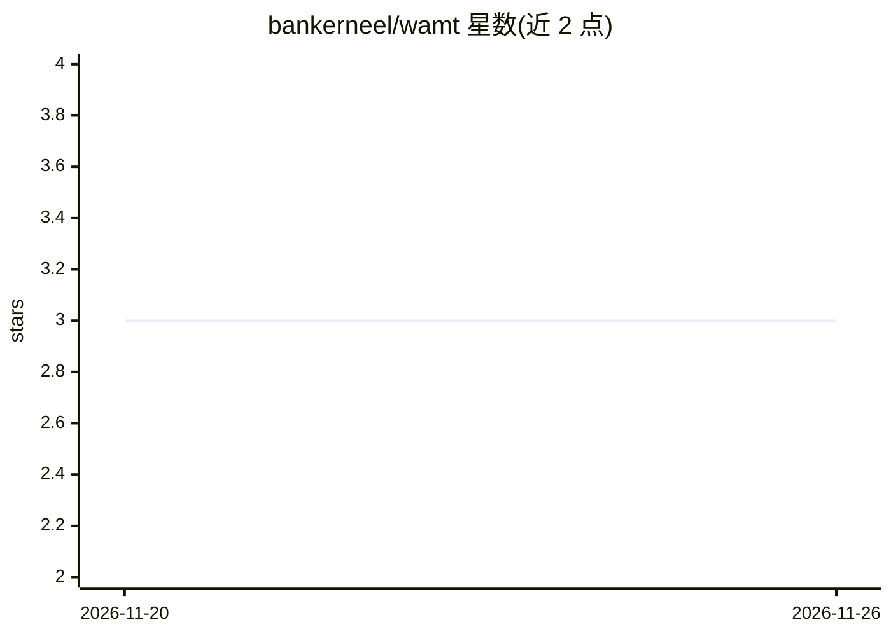

# bankerneel/wamt

⭐ 3 · Rust · MIT · 推送 2026-11-20 · [GitHub](https://github.com/bankerneel/wamt) · [官网](https://whoatemytokens.neelbanker.com) · 个人维护

**本地只读的 agent token 观测面板：用量、限额与成本**

面向 T3 Code、Claude Code 和 Codex 用户的本地 token 观测层：读取本地会话转录与 SQLite 数据库，展示活跃线程与 subagent、5 小时与每周限额、30 天历史及按项目汇总的 API 等价成本。单 Rust 二进制、Web 页面、仅监听 127.0.0.1、无外发请求、只读元数据不读取消息内容。macOS 为一级目标，Linux 可运行服务端，需从源码构建。

## 筛选速览

| 维度 | 判定 | 备注 |
|---|---|---|
| AI 角色 | `ai-ecosystem` | LLM/agent 周边工具 |
| 许可风险 | `permissive` | MIT |
| 部署形态 | `None` |  |
| 模型依赖 | — | README 未给出锁定关系 |
| 硬件要求 | — | 无带数字的原话,不猜 |
| 安装摩擦 | `medium` | 含编译或系统依赖之一 |
| 成熟度 | — | 结构信号不足 |

## 能力要点

- 实时展示线程、subagent、模型、上下文占用与 token 时间线
- 5 小时/每周限额仪表，可与 Claude Code statusline 的 rate_limits 数据校准
- 按项目 30 天成本汇总、CSV 导出、桌面通知与 /api/brief 摘要接口
- 只读本地数据，无外发请求，含合成数据的 demo 模式

## 适用场景

- 监控 Claude Code/Codex 会话的 token 消耗与限额进度
- 按项目统计 30 天 token 成本用于汇报
- 发现重上下文、过期缓存等 token 浪费点

## 场景标签

`LLM 可观测性` · 领域:评测与运维

## 证据(README 行号)

> L12: A local, read-only token observation layer for T3 Code, Claude Code and Codex. It shows live threads and subagents 
> L85: - Linux works for the server itself; the macOS-only launcher is not needed. The Docker scripts below run the Linux 

## 星数曲线

2026-11-20 3 → 2026-11-26 3（+0）

---
*卡片 v1 · prompt 1.4 · 生成 2026-11-22 · 置信度 high · 依据 README sha `d0084f3f9c1a` · [字段定义](../../DATASET.md)*
