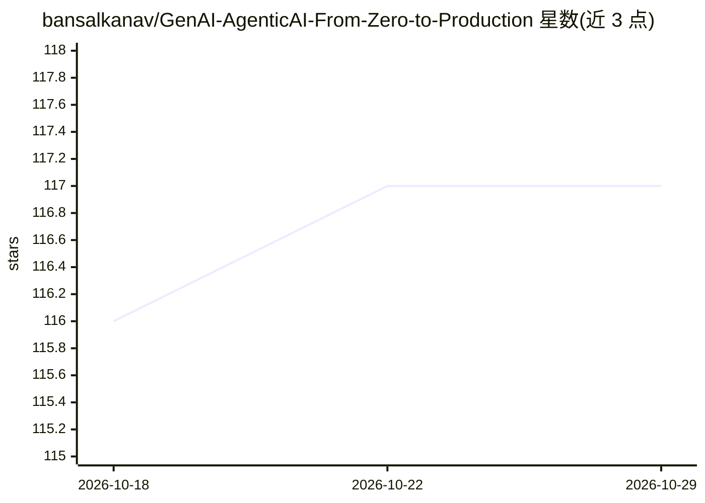

# bansalkanav/GenAI-AgenticAI-From-Zero-to-Production

⭐ 117 · Jupyter Notebook · 推送 2026-05-10 · [GitHub](https://github.com/bansalkanav/GenAI-AgenticAI-From-Zero-to-Production) · 个人维护

**从零到生产学习 GenAI 与 Agentic AI 的教程仓库**

主题标签显示这是一个学习生成式 AI 与 Agentic AI 的教学仓库，覆盖从零基础到生产部署的路径，涉及 LangChain、LangGraph、ChromaDB、HuggingFace Transformers、Azure Foundry、Gemini、Groq API 等工具链，并包含 hybrid-search、DeepEval、DeepAgents 等专题。README 正文仅含标题，内容以代码与教程目录形式组织，具体章节与运行方式无法从可见内容确认。

## 筛选速览

| 维度 | 判定 | 备注 |
|---|---|---|
| AI 角色 | `ai-knowledge` | 知识聚合/清单类 |
| 许可风险 | `none` | — |
| 部署形态 | `None` |  |
| 模型依赖 | — | README 未给出锁定关系 |
| 硬件要求 | — | 无带数字的原话,不猜 |
| 安装摩擦 | `low` | 无编译、无系统依赖或容器化 |
| 成熟度 | — | 结构信号不足 |

## 能力要点

- 主题覆盖 LangChain/LangGraph/ChromaDB/HuggingFace Transformers 等工具链
- 涉及 Azure Foundry、Gemini、Groq API 等服务端接口

## 适用场景

- 系统学习 GenAI 与 Agentic AI 开发
- 参考 LangChain/LangGraph 生态的实践代码

## 场景标签

`教程课程` · 领域:学习与行业

## 证据(README 行号)

> L1: # GenAI-AgenticAI-From-Zero-to-Production

## 星数曲线

2026-10-18 116 → 2026-10-29 117（+1）

---
*卡片 v1 · prompt 1.4 · 生成 2026-10-23 · 置信度 low · 依据 README sha `832c12a4cf83` · [字段定义](../../DATASET.md)*
