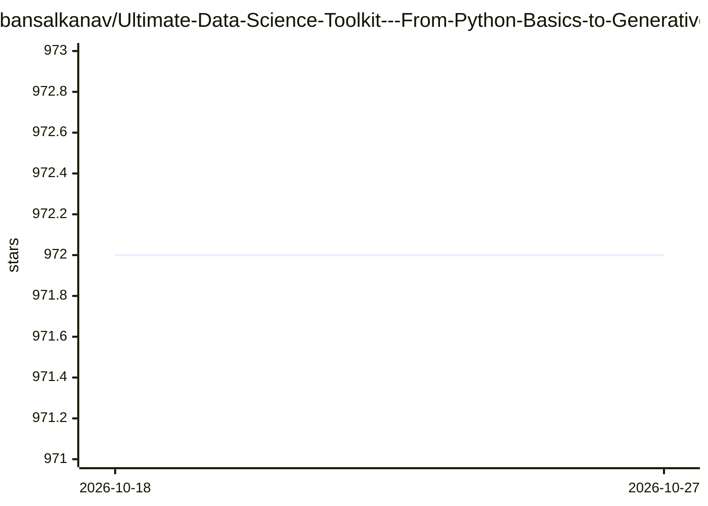

# bansalkanav/Ultimate-Data-Science-Toolkit---From-Python-Basics-to-GenerativeAI

⭐ 972 · Jupyter Notebook · GPL-3.0 · 推送 2026-04-08 · [GitHub](https://github.com/bansalkanav/Ultimate-Data-Science-Toolkit---From-Python-Basics-to-GenerativeAI) · 个人维护

**数据科学与生成式 AI 学习课程仓库，含 MLOps 与案例**

以 9 个模块组织的机器学习/深度学习教学仓库：从 Python 基础、Numpy/Pandas 数据分析、统计检验，到 SKLearn 监督/无监督算法、MLFlow 与 Prefect 的 MLOps 流程、深度学习（TensorFlow.Keras、CNN、自编码器），再到生成式 AI 模块（文本嵌入、Transformers、LangChain、RAG、LangGraph、Agentic AI）。各模块以主题表格列目录，部分标注 Coming Soon。面向学习者的课程内容而非可安装运行的软件产品。

## 筛选速览

| 维度 | 判定 | 备注 |
|---|---|---|
| AI 角色 | `ai-knowledge` | 知识聚合/清单类 |
| 许可风险 | `viral` | GPL-3.0 |
| 部署形态 | `None` |  |
| 模型依赖 | — | README 未给出锁定关系 |
| 硬件要求 | — | 无带数字的原话,不猜 |
| 安装摩擦 | `low` | 无编译、无系统依赖或容器化 |
| 成熟度 | `idea` | |

## 能力要点

- 9 个模块覆盖 Python 到生成式 AI 的学习路径
- MLOps 内容含 MLFlow 实验跟踪与 Prefect 流水线编排
- 7 类实战案例（回归/分类/NLP/聚类/部署/爬虫）
- 生成式 AI 模块含 RAG、LangGraph 编排与 Agentic AI 主题

## 适用场景

- 系统学习从 Python 到深度学习的完整路径
- 了解 MLFlow/Prefect 等 MLOps 工具的用法
- 按主题查找数据科学面试准备内容

## 场景标签

`教程课程` · 领域:学习与行业

## 证据(README 行号)

> L5:  Module 1 - Python Programming
> L100:  Module 9 - Generative AI

## 星数曲线

2026-10-18 972 → 2026-10-27 972（+0）

---
*卡片 v1 · prompt 1.4 · 生成 2026-10-21 · 置信度 high · 依据 README sha `2a2acc2f475b` · [字段定义](../../DATASET.md)*
