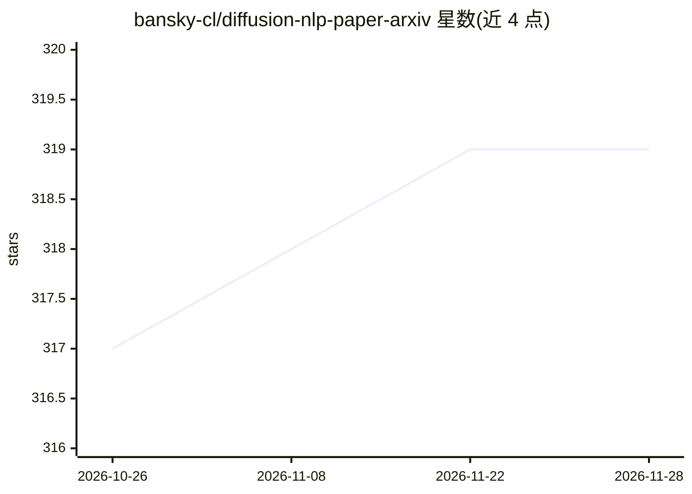

# bansky-cl/diffusion-nlp-paper-arxiv

⭐ 319 · Python · 推送 2026-11-27 · [GitHub](https://github.com/bansky-cl/diffusion-nlp-paper-arxiv) · [官网](https://github.com/bansky-cl/Diffusion-LM-Papers) · 个人维护

**自动聚合 arXiv 上扩散模型 NLP 论文的清单仓库**

该仓库以表格形式按日期自动收录 arXiv 上扩散语言模型相关论文，字段包含日期、标题、arXiv 分类、摘要链接、PDF 与代码链接，每月更新趋势内容。README 指向另一仓库 "Diffusion-LM-Papers" 提供更细致的策展条目。它本身不提供可运行代码或安装流程，仅作为论文信息聚合与检索入口，面向跟踪扩散 LM 研究进展的研究者。

## 筛选速览

| 维度 | 判定 | 备注 |
|---|---|---|
| AI 角色 | `ai-knowledge` | 知识聚合/清单类 |
| 许可风险 | `none` | — |
| 部署形态 | `None` |  |
| 模型依赖 | — | README 未给出锁定关系 |
| 硬件要求 | — | 无带数字的原话,不猜 |
| 安装摩擦 | `low` | 无编译、无系统依赖或容器化 |
| 成熟度 | — | 结构信号不足 |

## 能力要点

- 按日期表格化列出扩散语言模型相关 arXiv 论文
- 每条含分类、摘要、PDF 与代码链接
- 定期更新并附月度趋势
- 关联另一策展仓库 Diffusion-LM-Papers

## 适用场景

- 跟踪扩散语言模型方向的最新论文
- 查找某篇论文的 PDF 与开源代码
- 了解该领域的月度研究趋势

## 场景标签

`精选清单` `科研工具` · 领域:学习与行业

## 证据(README 行号)

> L12: ## diffusion
> L14: |Date|Title|label|Abstract|PDF|Code|

## 星数曲线

2026-10-26 317 → 2026-11-28 319（+2）

---
*卡片 v1 · prompt 1.4 · 生成 2026-11-28 · 置信度 high · 依据 README sha `f13d06fdd8b5` · [字段定义](../../DATASET.md)*
