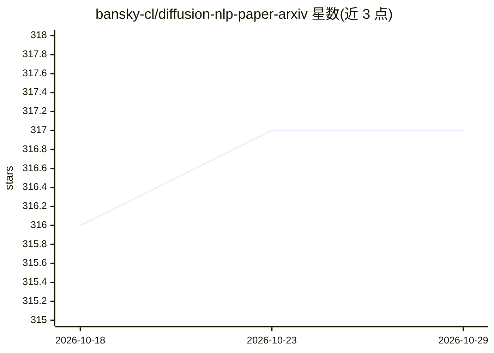

# bansky-cl/diffusion-nlp-paper-arxiv

⭐ 317 · Python · 推送 2026-10-28 · [GitHub](https://github.com/bansky-cl/diffusion-nlp-paper-arxiv) · [官网](https://github.com/bansky-cl/Diffusion-LM-Papers) · 个人维护

**自动抓取 arXiv 扩散 NLP 论文的月度追踪清单**

自动化聚合 arXiv 上扩散语言模型（diffusion LM）方向论文的清单仓库，按月列出趋势条目，每条含日期、标题、arXiv 分类标签、摘要、PDF 与代码链接；README 标注更新日期为 2026-10-21，并指向另一仓库 Diffusion-LM-Papers 提供更精细的策展。面向关注扩散模型文本生成的研究者，用于跟踪新论文，无可安装代码本体。

## 筛选速览

| 维度 | 判定 | 备注 |
|---|---|---|
| AI 角色 | `ai-knowledge` | 知识聚合/清单类 |
| 许可风险 | `none` | — |
| 部署形态 | `None` |  |
| 模型依赖 | — | README 未给出锁定关系 |
| 硬件要求 | — | 无带数字的原话,不猜 |
| 安装摩擦 | `low` | 无编译、无系统依赖或容器化 |
| 成熟度 | — | 结构信号不足 |

## 能力要点

- 自动从 arXiv 抓取扩散 NLP 论文并按月汇总
- 每条含日期、标题、分类、摘要与 PDF/代码链接
- 关联仓库 Diffusion-LM-Papers 提供更细策展

## 适用场景

- 我想跟踪扩散语言模型的最新 arXiv 论文
- 按月浏览该方向的论文趋势与摘要
- 顺链接找到论文代码与更完整的策展清单

## 场景标签

`精选清单` · 领域:学习与行业

## 证据(README 行号)

> L8: ## Updated on 2026.10.21
> L12: ## diffusion
> L16: |**2026-10-20**|**Binary Discrete Diffusion: Candidate-Set Diffusion for Logic and Planning Tasks**|cs.LG, cs.AI, c

## 星数曲线

2026-10-18 316 → 2026-10-29 317（+1）

---
*卡片 v1 · prompt 1.4 · 生成 2026-10-21 · 置信度 high · 依据 README sha `286ee648edaf` · [字段定义](../../DATASET.md)*
