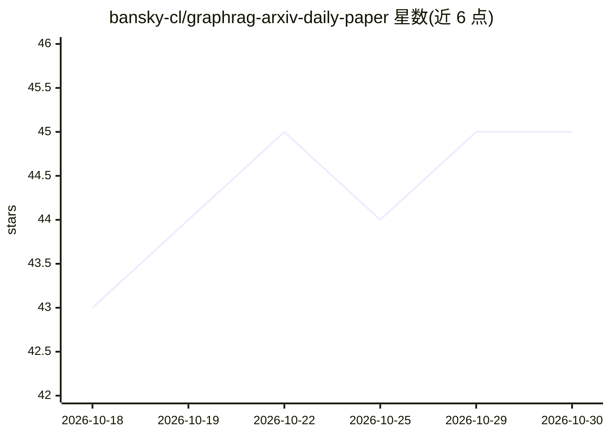

# bansky-cl/graphrag-arxiv-daily-paper

⭐ 45 · Python · 推送 2026-10-08 · [GitHub](https://github.com/bansky-cl/graphrag-arxiv-daily-paper) · 个人维护

**arXiv GraphRAG 论文每日追踪清单**

自动追踪 arXiv 上 GraphRAG 相关论文的聚合仓库：按日期列出论文标题、arXiv 编号与代码链接（部分条目标注 code），提供最近月份提交量汇总与月度趋势，并按 graphrag 等主题分类组织条目。面向关注 GraphRAG、知识图谱推理、图增强检索生成方向的科研人员与开发者，用于跟进领域最新论文。README 未展示具体的运行或生成机制细节。

## 筛选速览

| 维度 | 判定 | 备注 |
|---|---|---|
| AI 角色 | `ai-knowledge` | 知识聚合/清单类 |
| 许可风险 | `none` | — |
| 部署形态 | `None` |  |
| 模型依赖 | — | README 未给出锁定关系 |
| 硬件要求 | — | 无带数字的原话,不猜 |
| 安装摩擦 | `low` | 无编译、无系统依赖或容器化 |
| 成熟度 | — | 结构信号不足 |

## 能力要点

- 按日期列出 GraphRAG 相关 arXiv 论文及 PDF/代码链接
- 提供最近月份（2026-10）论文数量汇总（6 篇）
- 按 graphrag 等主题分类组织论文条目

## 适用场景

- 每日/每月跟进 GraphRAG 领域最新 arXiv 论文
- 查找附带开源代码的 GraphRAG 研究工作
- 了解知识图谱推理与图增强 RAG 的研究动态

## 场景标签

`精选清单` `科研工具` · 领域:学习与行业

## 证据(README 行号)

> L6: This repository tracks the latest GraphRAG related papers from arXiv.
> L12: ## Recent Month Summary (2026-10)

## 星数曲线

2026-10-18 43 → 2026-10-30 45（+2）

---
*卡片 v1 · prompt 1.4 · 生成 2026-10-25 · 置信度 mid · 依据 README sha `f5f9afb20fc1` · [字段定义](../../DATASET.md)*
