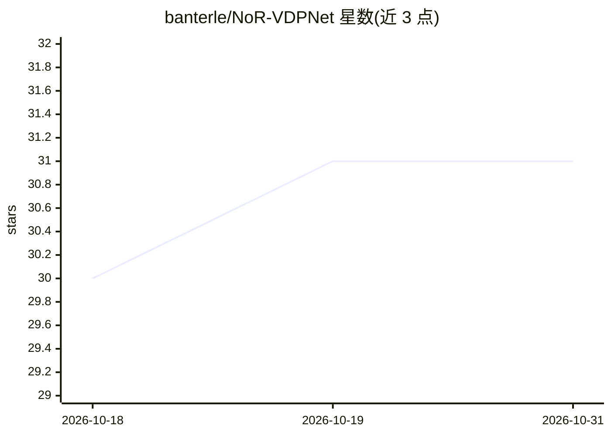

# banterle/NoR-VDPNet

⭐ 31 · Python · BSD-3-Clause-Clear · 推送 2026-07-07 · [GitHub](https://github.com/banterle/NoR-VDPNet) · 个人维护

**无参考 HDR/SDR 图像质量评估深度学习指标（HDR-VDP 训练版）**

基于深度学习的无参考图像质量指标，以 HDR-VDP 的输出 Q 值为训练目标，仅需单张图像即可评估质量，支持 HDR 与 SDR 图像。提供针对 SDR、JPEG-XT 压缩、色调映射、逆色调映射四类失真的预训练权重（可自动下载），并支持自建数据集（先用 HDR-VDP 生成失真图像的 Q 值）后用 train.py 训练。限制：权重仅适用于训练时对应的失真类型，跨失真或 HDR/SDR 混用不被允许。

## 筛选速览

| 维度 | 判定 | 备注 |
|---|---|---|
| AI 角色 | `ai-native` | 本体是模型或模型工具 |
| 许可风险 | `viral` | BSD-3-Clause-Clear |
| 部署形态 | `library` | 以包/库形式分发 |
| 模型依赖 | — | README 未给出锁定关系 |
| 硬件要求 | — | 无带数字的原话,不猜 |
| 安装摩擦 | `low` | 无编译、无系统依赖或容器化 |
| 成熟度 | — | 结构信号不足 |

## 能力要点

- 无参考质量评估，单张图像即可预测 HDR-VDP 的 Q 值
- 支持 SDR/HDR 的 JPEG、PNG、EXR、HDR、MAT 文件输入
- 提供 SDR/JPEG-XT/TMO/ITMO 四类失真的预训练权重
- 支持自建数据集训练（train.py，可配置 epoch/batch/lr）

## 适用场景

- 无参考图像可用时评估 HDR/SDR 图像质量
- 评估 JPEG-XT 压缩或色调映射后的图像失真程度
- 针对特定失真类型训练自己的质量评估模型

## 场景标签

 · 领域:图像质量评估/HDR 成像

## 证据(README 行号)

> L2: NoR-VDPNet is a deep-learning based no-reference metric trained on HDR-VDP.
> L7: NoR-VDPNet is a no-reference metric, so it requires a single image in order to asses its quality. NoR-VDPNet can be 

## 星数曲线

2026-10-18 30 → 2026-10-31 31（+1）

---
*卡片 v1 · prompt 1.4 · 生成 2026-10-26 · 置信度 mid · 依据 README sha `ffc7b1d5a596` · [字段定义](../../DATASET.md)*
