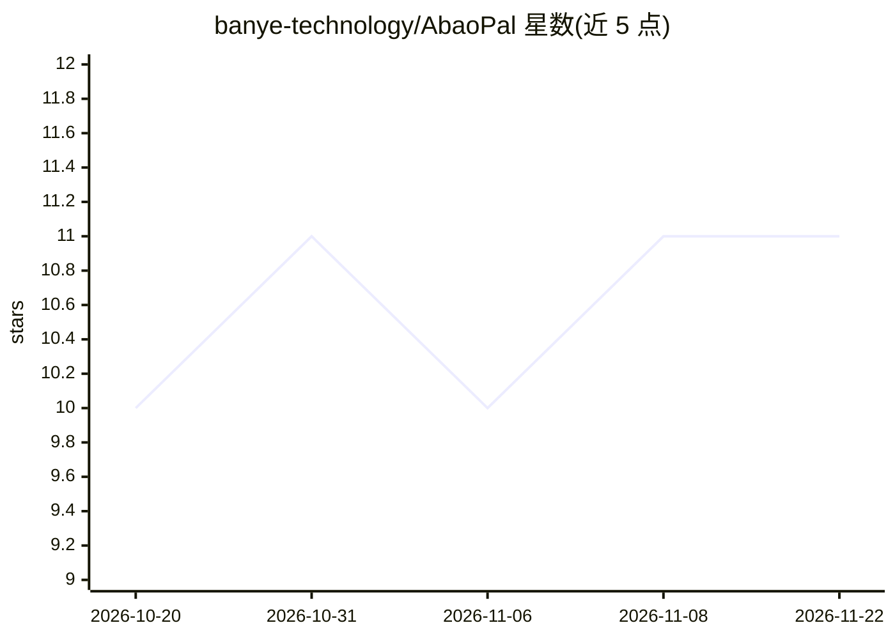

# banye-technology/AbaoPal

⭐ 11 · Kotlin · MIT · 推送 2026-08-04 · [GitHub](https://github.com/banye-technology/AbaoPal) · 组织维护 · 中文 README

**Android 手机自动化 Agent：自然语言驱动跨应用执行操作**

运行在 Android 端的开源手机自动化 Agent：用户用自然语言描述目标，由规划、执行、动作落地与结果判断多个 Agent 协作，结合无障碍 UI 树与截图理解界面，通过点击、滑动、输入跨应用完成多步任务。支持操作录制回放、YAML 自定义 Skills 配合向量检索、语音输入唤醒与定时任务。面向 Android 8.0+（arm64-v8a）设备，从源码用 Android Studio/Gradle 构建，完整流程需阿里云百炼 API Key，支付、密码等场景要求人工接管。

## 筛选速览

| 维度 | 判定 | 备注 |
|---|---|---|
| AI 角色 | `ai-native` | 本体是模型或模型工具 |
| 许可风险 | `permissive` | MIT |
| 部署形态 | `None` |  |
| 模型依赖 | — | README 未给出锁定关系 |
| 硬件要求 | — | 无带数字的原话,不猜 |
| 安装摩擦 | `medium` | 含编译或系统依赖之一 |
| 成熟度 | `idea` | |

## 能力要点

- 双通道界面感知：无障碍 UI 树 + Android 11+ 无障碍截图
- 多 Agent 协作执行循环与悬浮助手入口
- 操作录制为可编辑指令集并支持回放
- YAML 自定义 Skills + 本地向量存储检索任务上下文

## 适用场景

- 用一句话让手机自动打开设置并找到功能入口
- 录制重复操作流程，之后一键回放
- 为常用应用编写 Skill 沉淀自动化经验
- 通过语音或定时方式触发手机任务

## 场景标签

`GUI 自动化` `多智能体` · 领域:Agent 开发

## 证据(README 行号)

> L22: 阿宝PAl是一款运行在 Android 端的开源手机自动化 Agent。你描述目标，它读取当前界面、规划步骤、执行点击与输入，再根据屏幕反馈继续行动。
> L57:  👀 双通道界面感知 结合无障碍 UI 树与屏幕截图，让文本模型与视觉模型各展所长。
> L58:  🧠 多 Agent 协作 规划、执行、动作落地与结果判断分工协作，形成持续反馈循环。
> L262: - 仅构建 `arm64-v8a`；不支持 x86 模拟器及 32 位设备。

## 星数曲线

2026-10-20 10 → 2026-11-22 11（+1）

---
*卡片 v1 · prompt 1.4 · 生成 2026-11-18 · 置信度 high · 依据 README sha `fc245967fbf0` · [字段定义](../../DATASET.md)*
