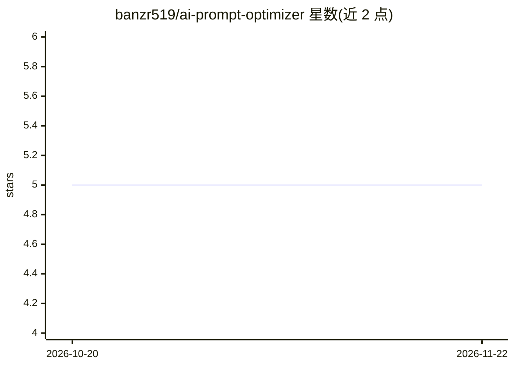

# banzr519/ai-prompt-optimizer

⭐ 5 · Python · MIT · 推送 2026-10-27 · [GitHub](https://github.com/banzr519/ai-prompt-optimizer) · 个人维护 · 中文 README

**提示词优化与需求澄清的 Agent 技能，供 AI agent 用户精炼指令**

一个基于指令的 Agent Skill（SKILL.md），用于优化提示词、审计冲突指令、在 agent 执行任务前澄清需求与验收标准，覆盖编码、设计、写作、分析与规划。包含 34 个语义模式、10 个领域指南和 8 个教学示例，按需加载；保留数字、名称、排除项与范围。不要求 API key，通过 Codex 安装器（需 Python 3.9+）或手动复制到 ~/.agents/skills/ 使用，也可粘贴到普通聊天作为指导。作者声明个别模型集成未逐一测试。

## 筛选速览

| 维度 | 判定 | 备注 |
|---|---|---|
| AI 角色 | `ai-knowledge` | 知识聚合/清单类 |
| 许可风险 | `permissive` | MIT |
| 部署形态 | `None` |  |
| 模型依赖 | — | README 未给出锁定关系 |
| 硬件要求 | — | 无带数字的原话,不猜 |
| 安装摩擦 | `low` | 无编译、无系统依赖或容器化 |
| 成熟度 | — | 结构信号不足 |

## 能力要点

- 34 个语义模式、10 个领域指南、8 个教学示例，按需加载
- 支持仅精炼、澄清后执行、冲突审计三种输出模式
- 兼容标准 SKILL.md 结构，可粘贴至普通聊天作为回退用法
- 30 个语言/locale 条目的多语言 README 与入门文档

## 适用场景

- 把模糊的请求改写成清晰可执行的任务指令
- 在让 agent 执行前澄清需求边界与验收标准
- 检查提示词中的冲突要求与缺失要素
- 在无 Skills 的普通聊天中粘贴 SKILL.md 作为指导

## 场景标签

`提示工程` · 领域:Agent 开发

## 证据(README 行号)

> L17: AI Prompt Optimizer is a **prompt optimization and requirements clarification Agent Skill**. Use it to improve prom
> L104: **Documented model families:** GPT, DeepSeek, Claude, Gemini, Qwen, Doubao, Hunyuan, ERNIE, GLM, Kimi, MiniMax, Gr
> L113: This is a skill, not a hosted web app, model, browser extension or automatic model-settings switch. It cannot crea

## 星数曲线

2026-10-20 5 → 2026-11-22 5（+0）

---
*卡片 v1 · prompt 1.4 · 生成 2026-11-21 · 置信度 high · 依据 README sha `22643e3c36a1` · [字段定义](../../DATASET.md)*
