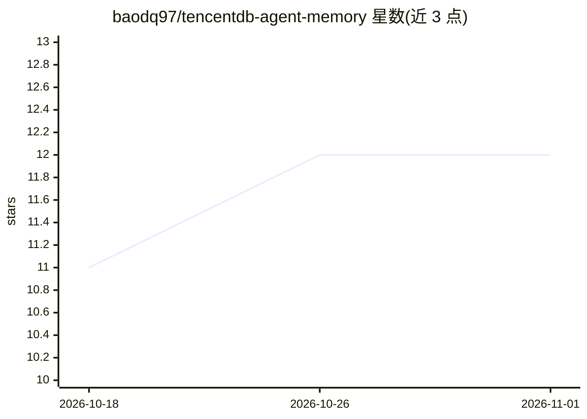

# baodq97/tencentdb-agent-memory

⭐ 12 · JavaScript · NOASSERTION · 推送 2026-09-07 · [GitHub](https://github.com/baodq97/tencentdb-agent-memory) · 个人维护

**Claude Code 四层长期记忆插件，本地 FTS5+向量混合召回**

为 Claude Code 提供四层长期记忆（L0 会话→L1 原子→L2 场景→L3 人格）的插件，另提供独立 tmem CLI。全程本地运行，无外部网关与付费 API、无需 Python；抽取与巩固由 Claude agent 自身完成。召回采用 FTS5 关键词 + EmbeddingGemma-300M 向量经 RRF 合并，人格按职责分三层注入并设 token 预算；巩固以脱离会话的 headless 子进程运行，成功以存储增量为度量。附加 /contrib 贡献者画像功能（需 gh CLI）。要求 Node ≥ 24，嵌入模型约 314MB 首次使用时下载。

## 筛选速览

| 维度 | 判定 | 备注 |
|---|---|---|
| AI 角色 | `ai-ecosystem` | LLM/agent 周边工具 |
| 许可风险 | `none` | NOASSERTION |
| 部署形态 | `library` | 以包/库形式分发 |
| 模型依赖 | — | README 未给出锁定关系 |
| 硬件要求 | — | 无带数字的原话,不猜 |
| 安装摩擦 | `low` | 无编译、无系统依赖或容器化 |
| 成熟度 | — | 结构信号不足 |

## 能力要点

- L0→L1→L2→L3 四层记忆管道，含 Capture/Consolidate/Recall/Maintain 四阶段
- FTS5 + EmbeddingGemma 向量混合召回（RRF 合并、相关性下限）
- 完全本地运行：无外部网关、无付费 API、无 Python
- tmem view 只读可视化器，用 SQLite readOnly 强制不写入

## 适用场景

- 让 Claude Code 跨会话记住我的偏好与项目上下文
- 审计 agent 实际注入了哪些记忆与人格条目
- 分析 GitHub 工程师工作方式并生成可模仿的 playbook

## 场景标签

`Agent 记忆` · 领域:Agent 开发

## 证据(README 行号)

> L7: Four-layer long-term memory (L0 Conversation → L1 Atom → L2 Scene → L3 Persona) for Claude Code, inspired by Tencent
> L9: Fully local — no external Gateway, no paid API, no Python. All extraction and consolidation is done by the Claude ag
> L218: |**Capture**|Transcript → Atoms (deterministic digest of tool blocks; hook auto-capture)|`session_digest`, `digest

## 星数曲线

2026-10-18 11 → 2026-11-01 12（+1）

---
*卡片 v1 · prompt 1.4 · 生成 2026-11-01 · 置信度 high · 依据 README sha `5e56f0088b09` · [字段定义](../../DATASET.md)*
