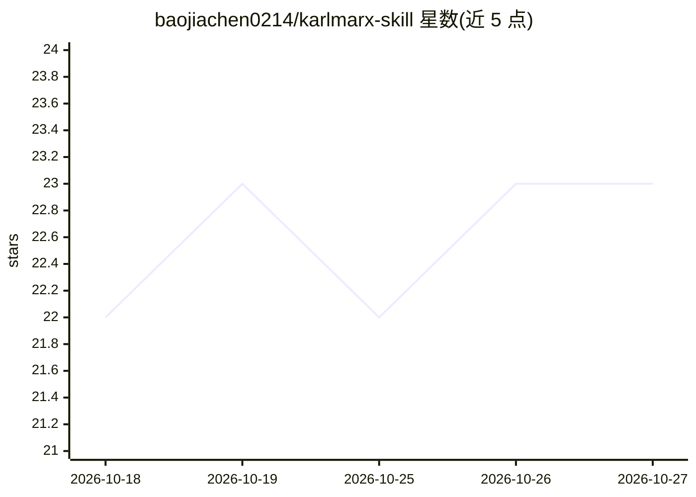

# baojiachen0214/karlmarx-skill

⭐ 23 · MIT · 推送 2026-04-05 · [GitHub](https://github.com/baojiachen0214/karlmarx-skill) · 个人维护 · 中文 README

**给 AI 注入马克思主义方法论的深度结构分析技能**

一个面向 AI 助手的 skill（提示工程资产），宣称让 AI 运用唯物辩证法进行深度思考：包括普遍联系观点、矛盾分析、本质与现象、中介与层次、实践检验标准五个分析维度，输出可测试的干预点而非套话式回答。README 自述其为方法论工具而非政治立场，提供机制性解释，并在经济学或心理学更适用时让位。以 MIT 许可发布，README 提供英/中/日/德/法/西/俄/葡/意/韩多语言版本。

## 筛选速览

| 维度 | 判定 | 备注 |
|---|---|---|
| AI 角色 | `ai-knowledge` | 知识聚合/清单类 |
| 许可风险 | `permissive` | MIT |
| 部署形态 | `None` |  |
| 模型依赖 | — | README 未给出锁定关系 |
| 硬件要求 | — | 无带数字的原话,不猜 |
| 安装摩擦 | `low` | 无编译、无系统依赖或容器化 |
| 成熟度 | — | 结构信号不足 |

## 能力要点

- 五个辩证法分析维度（普遍联系/矛盾分析/本质现象/中介层次/实践标准）
- 输出结构、矛盾、杠杆点的结构化分析模板
- 多语言 README（10 种语言）

## 适用场景

- 让 AI 在分析问题时输出结构化、机制性的回答而非表面套话
- 作为 Claude 类 agent 的技能使用，获得第一性原理式深度分析

## 场景标签

`提示工程` · 领域:Agent 开发

## 证据(README 行号)

> L15:  Arming AI with Marxist Theory, Truly Returning to First Principles
> L65: KarlMarx Skill is a **structural analysis tool of Marxist methodology**, not a political position or ideological st

## 星数曲线

2026-10-18 22 → 2026-10-27 23（+1）

---
*卡片 v1 · prompt 1.4 · 生成 2026-10-27 · 置信度 mid · 依据 README sha `f0b0463caba2` · [字段定义](../../DATASET.md)*
