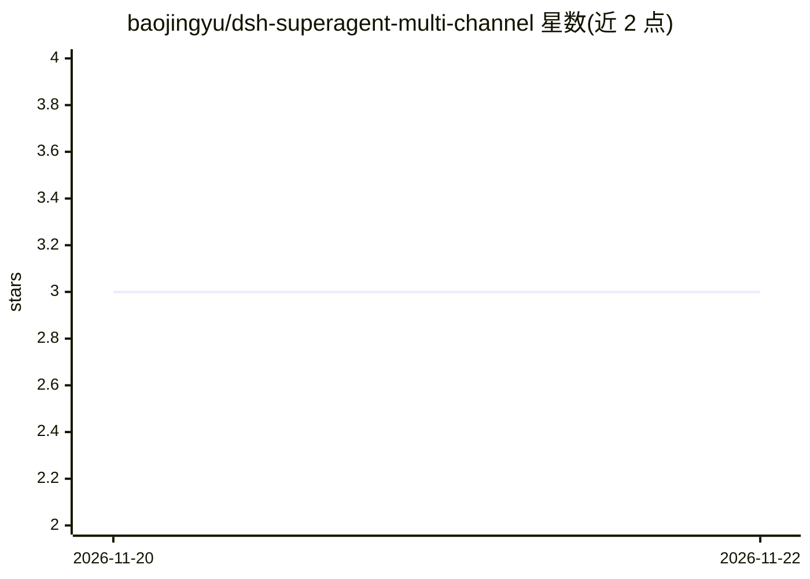

# baojingyu/dsh-superagent-multi-channel

⭐ 3 · TypeScript · MIT · 推送 2026-11-18 · [GitHub](https://github.com/baojingyu/dsh-superagent-multi-channel) · 个人维护 · 中文 README

**为 DSH 超级智能体接入六渠道消息的插件**

DSH 官方超级智能体的扩展插件：在保留官方飞书、GitHub 两个来源的基础上新增微信、企业微信、钉钉、云效项目四个来源，统一为「评估→工单→执行→回复」循环。每条消息经四道门控（启用来源、白名单、结构化 @、模型评估）决定是否受理；执行在隔离会话与独立目录/分支中进行，结果回写原会话，可回写工作项状态。全部状态存于本地 stateDir，人可在任一步骤接管。通过插件管理器（目录/npm 包/tarball）安装。

## 筛选速览

| 维度 | 判定 | 备注 |
|---|---|---|
| AI 角色 | `ai-ecosystem` | LLM/agent 周边工具 |
| 许可风险 | `permissive` | MIT |
| 部署形态 | `desktop` | 安装包/桌面程序 |
| 模型依赖 | — | README 未给出锁定关系 |
| 硬件要求 | — | 无带数字的原话,不猜 |
| 安装摩擦 | `low` | 无编译、无系统依赖或容器化 |
| 成熟度 | — | 结构信号不足 |

## 能力要点

- 六个消息源统一为一个 Trigger 形状，单渠道支持多实例
- 四道门控与评估决策记录强度与证据，不通过则仅观察
- 隔离执行器会话与独立目录/分支，支持人工接管与补充输入
- 微信双配置：personal（iLink，跨 OS，仅私聊）与 team（Windows 数据库副本，群触发/历史/花名册）

## 适用场景

- 在云效工作项上被 @ 后自动开单修复缺陷并回写状态
- 微信群运维值守：@机器人执行查询类任务
- 企业微信私聊下发文案修改并回收结果文件

## 场景标签

`工作流自动化` `聊天机器人` `AI 写作` `编码 Agent` · 领域:效率与自动化

## 证据(README 行号)

> L5: **A DSH plugin that wires Feishu, GitHub, WeChat, WeCom, DingTalk and Alibaba Cloud Yunxiao Projex into one
> L10: > An extension of the official open-source superagent: the two official sources (Feishu, GitHub) stay as they are, 
> L19: Someone mentions the bot or messages it on any of six channels → the plugin reads the context under the policy and 

## 星数曲线

2026-11-20 3 → 2026-11-22 3（+0）

---
*卡片 v1 · prompt 1.4 · 生成 2026-11-22 · 置信度 high · 依据 README sha `e4e4c2825533` · [字段定义](../../DATASET.md)*
