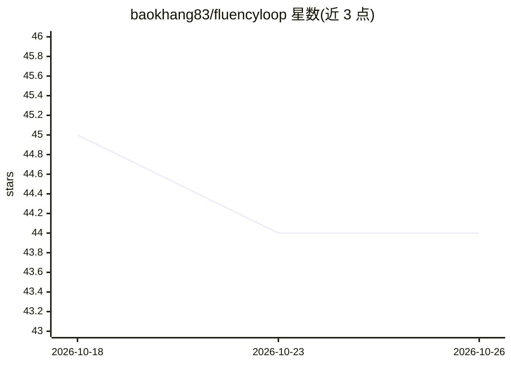

# baokhang83/fluencyloop

⭐ 44 · HTML · Apache-2.0 · 推送 2026-08-16 · [GitHub](https://github.com/baokhang83/fluencyloop) · [官网](https://baokhang83.github.io/fluencyloop/) · 个人维护

**面向 Claude Code/Codex 的 AI 结对开发工作流插件：边写代码边沉淀决策知识**

以插件形式安装到 Claude Code 与 Codex 的开发工作流工具。工作流为 init→feature→review：每个功能分支上，agent 构建时记录设计决策、所选路径与被否方案，并在决策发生时向开发者按其熟悉度讲解；维护可检核的项目 constitution 与按开发者私有的知识画像（不入库）。记录以追加式 JSONL 存于 docs/fluencyloop/，可生成仅绑定 127.0.0.1 的本地项目知识站点（需可选的 Node.js 18+）。依赖 git 与 Bash/PowerShell，状态为 beta。

## 筛选速览

| 维度 | 判定 | 备注 |
|---|---|---|
| AI 角色 | `ai-ecosystem` | LLM/agent 周边工具 |
| 许可风险 | `permissive` | Apache-2.0 |
| 部署形态 | `None` |  |
| 模型依赖 | locked-api |  |
| 硬件要求 | — | 无带数字的原话,不猜 |
| 安装摩擦 | `low` | 无编译、无系统依赖或容器化 |
| 成熟度 | `idea` | |

## 能力要点

- init→plan→feature→review 工作流，feature 阶段构建并逐条记录真实决策
- 决策记录含选择理由、被否替代方案与 constitution 对照
- 追加式 JSONL 存储于仓库内 docs/fluencyloop/，随代码提交
- 本地知识站点仅绑定 127.0.0.1，不向服务发送项目知识

## 适用场景

- 让 AI agent 写代码的同时保持对代码库决策的理解
- 为 PR 审查者组装含决策理由的评审视图
- 项目新人通过本地知识站点了解产品形态与变更历史

## 场景标签

`工作流自动化` `编码 Agent` · 领域:效率与自动化

## 证据(README 行号)

> L22: |Step|Claude Code|Codex|What it does|
> L100: ### Claude Code
> L137: codex plugin marketplace add baokhang83/fluencyloop

## 星数曲线

2026-10-18 45 → 2026-10-26 44（-1）

---
*卡片 v1 · prompt 1.4 · 生成 2026-10-25 · 置信度 high · 依据 README sha `abda745f76ad` · [字段定义](../../DATASET.md)*
