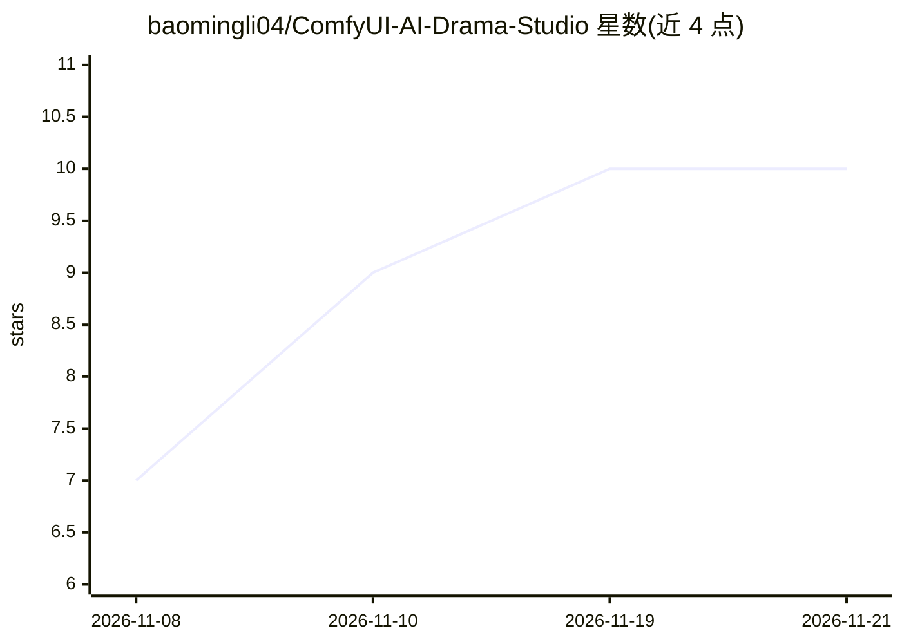

# baomingli04/ComfyUI-AI-Drama-Studio

⭐ 10 · Python · 推送 2026-11-08 · [GitHub](https://github.com/baomingli04/ComfyUI-AI-Drama-Studio) · 个人维护 · 中文 README

**本地运行的 AI 漫剧/短剧一站式生产平台，从剧本到成片**

基于 Django + Vue 的本地平台，串联 AI 剧本创作、人物设定、美术出图、AI 分镜拆解、单镜视频生成与 FFmpeg 一键合成全流程。图片与视频推理通过本机 ComfyUI 的 HTTP API 完成，工作流以「技能包」形式封装上传，可按页面自选与扩展。数据存本机 MySQL，无云服务与订阅。面向个人创作者、漫剧工作室与 AI 短剧团队；前提是本机已装并启动 ComfyUI、Python 3.11、Node.js 与 MySQL/MariaDB。

## 筛选速览

| 维度 | 判定 | 备注 |
|---|---|---|
| AI 角色 | `ai-native` | 本体是模型或模型工具 |
| 许可风险 | `none` | — |
| 部署形态 | `library` | 以包/库形式分发 |
| 模型依赖 | — | README 未给出锁定关系 |
| 硬件要求 | — | 无带数字的原话,不猜 |
| 安装摩擦 | `medium` | 含编译或系统依赖之一 |
| 成熟度 | — | 结构信号不足 |

## 能力要点

- 覆盖剧本→角色资产→出图→分镜→视频→成片的完整生产线
- ComfyUI 工作流封装为技能包（zip 上传/本地导入），按分类挂载自选
- 单镜导演台提供 8 种生成方式与版本历史管理
- 生成内容存本机，无云服务、无订阅

## 适用场景

- 从一句话创意跑通漫剧剧本到成片的整条流水线
- 把散装的 ComfyUI 工作流统一管起来并按页面调用
- 管理剧集资产清单与逐镜出图的版本历史
- 用 FFmpeg 把各镜正式版本自动拼接成片

## 场景标签

`图像生成` `视频生成` · 领域:内容生成

## 证据(README 行号)

> L10: > **AI 剧本创作 → 人物/资产设定 → 美术出图 → AI 分镜拆解 → 单镜生成视频（图生视频/文生视频/首尾帧/参考生视频）→ 一键合成成片** 全流程。
> L97: |推理后端|本机 ComfyUI（HTTP API，工作流经技能包调度）|
> L111: > 前置要求：本机已安装并启动 **ComfyUI**（默认 `127.0.0.1:8188`）、Python 3.11、Node.js、MySQL/MariaDB。

## 星数曲线

2026-11-08 7 → 2026-11-21 10（+3）

---
*卡片 v1 · prompt 1.4 · 生成 2026-11-19 · 置信度 high · 依据 README sha `9294f27afea3` · [字段定义](../../DATASET.md)*
