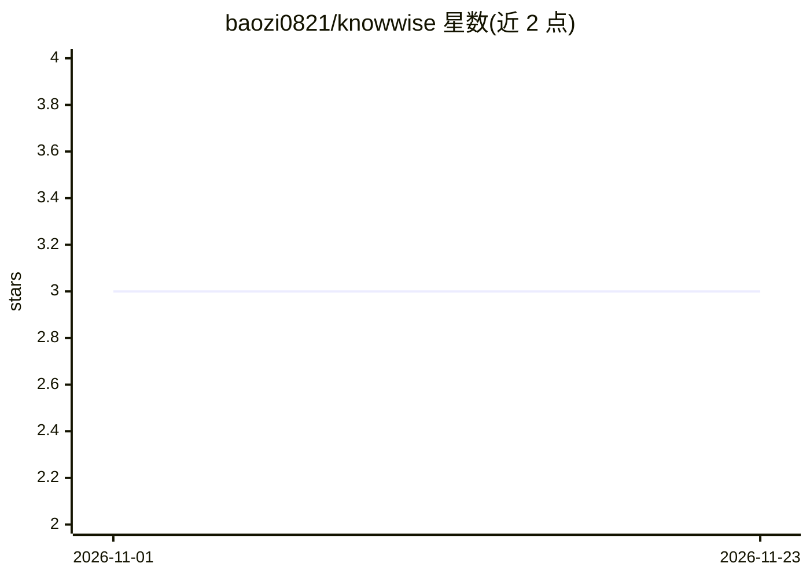

# baozi0821/knowwise

⭐ 3 · Rust · MIT · 推送 2026-11-01 · [GitHub](https://github.com/baozi0821/knowwise) · 个人维护 · 中文 README

**本地优先的 AI 文档阅读器：PDF/Markdown/DOCX 引用问答与离线 OCR**

基于 Tauri 2 + Rust + React 的桌面端文档阅读器，支持 PDF/Markdown/DOCX 阅读、按页/节/选区范围问答、可回跳定位的引用校验、离线 OCR、笔记标注、知识图谱与可导出学习产物。模型功能通过 OpenAI 兼容 API 或本地 Ollama 接入，所有远程请求经统一外发网关，API key 存入系统凭据库；可选 OPUS-MT ONNX 本地翻译引擎支持中英互译。文档、索引与笔记保存在本机 SQLite，未配置模型时阅读、搜索、OCR 等功能保持可用。提供 Windows NSIS/MSI 与 macOS DMG 安装包。

## 筛选速览

| 维度 | 判定 | 备注 |
|---|---|---|
| AI 角色 | `ai-native` | 本体是模型或模型工具 |
| 许可风险 | `permissive` | MIT |
| 部署形态 | `None` |  |
| 模型依赖 | local-ok | 支持本地模型 |
| 硬件要求 | — | 无带数字的原话,不猜 |
| 安装摩擦 | `low` | 无编译、无系统依赖或容器化 |
| 成熟度 | — | 结构信号不足 |

## 能力要点

- 按页/节/范围限定的问答与可回跳引用，无法定位的引用被标记为未验证
- 离线 OCR（Tesseract.js，英文/简中），无文本层页面自动识别，支持暂停/恢复/纠正
- 统一外发网关：文档级权限、载荷哈希、目的地白名单与审计事件
- 可选 OPUS-MT ONNX 本地翻译，中英双向离线运行

## 适用场景

- 在本地阅读文献并对指定页面/章节提问并核验引用出处
- 对无文本层的扫描版 PDF 做离线 OCR 与人工校对
- 在无网络或无模型环境下完成阅读、笔记与本地翻译

## 场景标签

`知识图谱` `科研工具` `OCR` `文档问答` · 领域:知识与检索

## 证据(README 行号)

> L3:  Local-first AI document reader for PDF, Markdown and DOCX.
> L14: Knowwise 是一个本地优先的 AI 文档阅读器：支持 PDF / Markdown / DOCX 阅读、按页/节/选区问答、可回跳引用、离线 OCR、翻译、笔记与标注、知识图谱，以及可编辑、可导出的产物。
> L123: All model-backed features use an OpenAI-compatible chat/completions API or a local Ollama instance.

## 星数曲线

2026-11-01 3 → 2026-11-23 3（+0）

---
*卡片 v1 · prompt 1.4 · 生成 2026-11-22 · 置信度 high · 依据 README sha `68e943eca774` · [字段定义](../../DATASET.md)*
