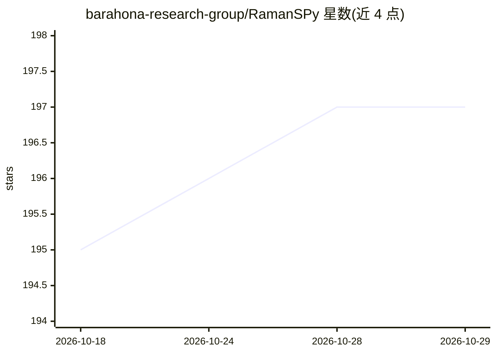

# barahona-research-group/RamanSPy

⭐ 197 · Jupyter Notebook · BSD-3-Clause · 推送 2025-11-09 · [GitHub](https://github.com/barahona-research-group/RamanSPy) · [官网](https://ramanspy.readthedocs.io) · 组织维护

**拉曼光谱数据分析 Python 库，含 AI/ML 集成**

面向拉曼光谱研究的开源 Python 包，提供通用数据格式、数据加载器、预处理方法（裁剪、宇宙射线去除、去噪、基线校正、归一化）、预处理管线与协议、分析方法、可视化工具、数据集、合成数据生成器与指标；AI 与机器学习集成作为其中一项功能列出。示例展示从商业拉曼仪器加载文件、构建预处理管线、执行光谱解混并可视化。经 pip 安装，附 ACS Analytical Chemistry 2024 论文可引用。

## 筛选速览

| 维度 | 判定 | 备注 |
|---|---|---|
| AI 角色 | `ai-enhanced` | 去掉 AI 部分产品仍成立 |
| 许可风险 | `permissive` | BSD-3-Clause |
| 部署形态 | `library` | 以包/库形式分发 |
| 模型依赖 | — | README 未给出锁定关系 |
| 硬件要求 | — | 无带数字的原话,不猜 |
| 安装摩擦 | `low` | 无编译、无系统依赖或容器化 |
| 成熟度 | — | 结构信号不足 |

## 能力要点

- 预处理管线与协议（裁剪/去噪/基线校正/归一化等）
- 支持商业拉曼仪器数据文件加载与光谱解混分析
- 内置数据集、合成数据生成器与可视化工具
- AI 与 ML 集成作为分析能力之一

## 适用场景

- 加载并预处理拉曼光谱仪器数据
- 构建光谱分析流程并可视化结果
- 研究中按论文引用并复用其数据集与指标

## 场景标签

`数据分析` · 领域:效率与自动化

## 证据(README 行号)

> L5: ## *RamanSPy*: An open-source package for <ins>Raman</ins> <ins>S</ins>pectroscopy analytics in <ins>Py</ins>thon.
> L19: - AI & ML integration

## 星数曲线

2026-10-18 195 → 2026-10-29 197（+2）

---
*卡片 v1 · prompt 1.4 · 生成 2026-10-22 · 置信度 mid · 依据 README sha `5147fcf16ed1` · [字段定义](../../DATASET.md)*
