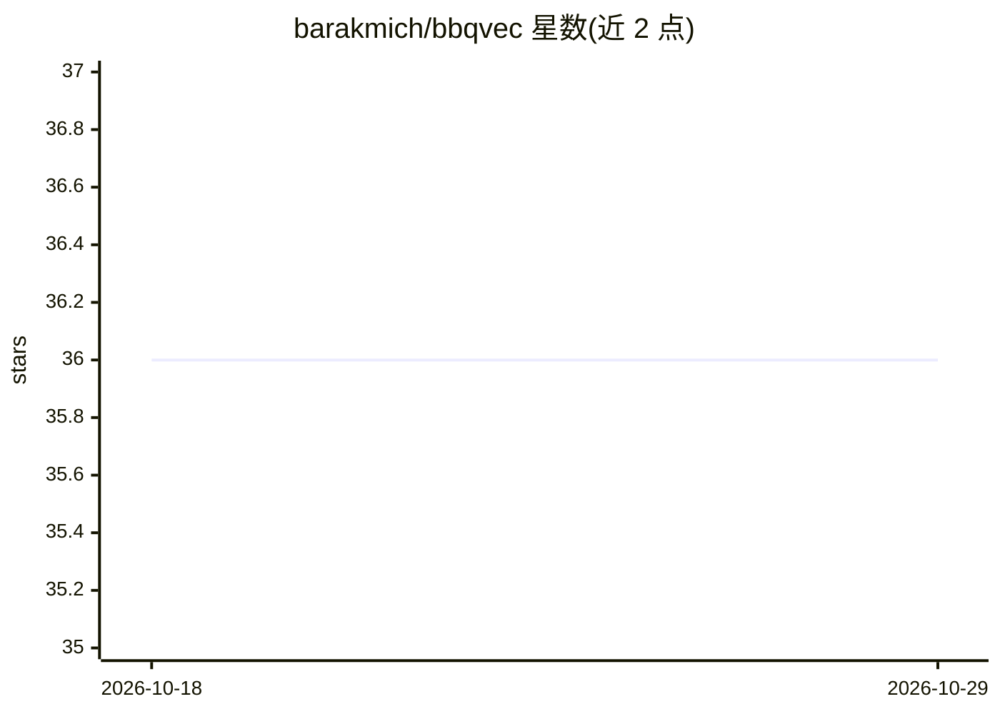

# barakmich/bbqvec

⭐ 36 · Rust · Apache-2.0 · 推送 2026-04-30 · [GitHub](https://github.com/barakmich/bbqvec) · 个人维护

**Go/Rust 嵌入式向量索引库，提供近似最近邻检索**

BBQvec 是开源的嵌入式向量数据库索引库，同时提供 Go 与 Rust 实现，用于近似 K 近邻（aKNN）检索与相似度搜索。Go 版本带 GoDoc 文档与 CI；Rust 版本通过 Crates.io 发布。项目自述仍处早期阶段：Go 实现相对成熟，Rust 实现速度更快但磁盘后端尚在开发中；两侧均有待完成项（基准测试、新量化方式如汉明距离/单比特向量）。面向在应用中嵌入向量检索能力的开发者。

## 筛选速览

| 维度 | 判定 | 备注 |
|---|---|---|
| AI 角色 | `ai-ecosystem` | LLM/agent 周边工具 |
| 许可风险 | `permissive` | Apache-2.0 |
| 部署形态 | `library` | 以包/库形式分发 |
| 模型依赖 | — | README 未给出锁定关系 |
| 硬件要求 | — | 无带数字的原话,不猜 |
| 安装摩擦 | `low` | 无编译、无系统依赖或容器化 |
| 成熟度 | `idea` | |

## 能力要点

- Go 与 Rust 双语言实现的嵌入式向量索引
- 提供近似 K 近邻（aKNN）检索
- Rust 版通过 Crates.io 发布，Go 版附 GoDoc

## 适用场景

- 在 Go/Rust 应用中嵌入向量相似度检索
- 为轻量场景提供无独立服务的向量索引能力

## 场景标签

`向量数据库` · 领域:知识与检索

## 证据(README 行号)

> L10: BBQvec is an open-source, embedded vector database index for Go and Rust, providing approximate K-nearest-neighbors
> L34: We're still early; Go is the more tried-and-true and suits the beta use-case, but Rust is a good deal faster. We we

## 星数曲线

2026-10-18 36 → 2026-10-29 36（+0）

---
*卡片 v1 · prompt 1.4 · 生成 2026-10-25 · 置信度 high · 依据 README sha `50025ad3bc4c` · [字段定义](../../DATASET.md)*
