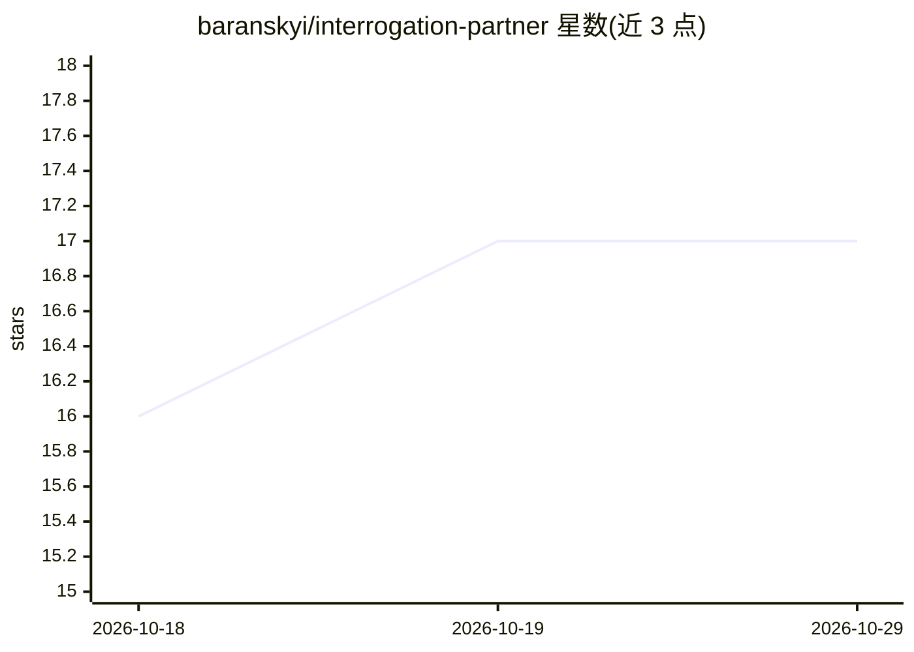

# baranskyi/interrogation-partner

⭐ 17 · MIT · 推送 2026-07-08 · [GitHub](https://github.com/baranskyi/interrogation-partner) · 个人维护

**对自我决策做苏格拉底式盘问的 Claude Agent Skill**

一个 Claude Code 插件 / Agent Skills 兼容技能：以审讯方法论（KUBARK、Scharff、PEACE、认知访谈等文献）为基础，对用户自带的叙事进行六阶段盘问——从基线陈述、漏斗式提问、探测矛盾到对峙，只提问不给建议，直到用户说出未承认的真实动机。伦理边界写入规则与评测：仅限本人自愿接受盘问、拒绝用于第三方、单个停止词可终止。提供 Claude Code 插件市场安装、git clone 手动安装及 Claude.ai/Desktop 技能上传三种方式，附三场景行为评测与英俄双语示例。

## 筛选速览

| 维度 | 判定 | 备注 |
|---|---|---|
| AI 角色 | `ai-native` | 本体是模型或模型工具 |
| 许可风险 | `permissive` | MIT |
| 部署形态 | `desktop` | 安装包/桌面程序 |
| 模型依赖 | — | README 未给出锁定关系 |
| 硬件要求 | — | 无带数字的原话,不猜 |
| 安装摩擦 | `low` | 无编译、无系统依赖或容器化 |
| 成熟度 | — | 结构信号不足 |

## 能力要点

- 六阶段盘话流程（Booking→Baseline→Funnel→Probe→Confrontation→Admission）
- 技法源自公开审讯文献（KUBARK、Scharff、PEACE、HIG 研究等）并附引用目录
- 伦理约束代码化：仅限本人自愿、拒绝第三方盘问、单停止词退出，含安全评测
- 三场景行为评测套件，可用 Anthropic skill-creator harness 运行

## 适用场景

- 对一个已预设答案的决策做压力测试（如是否离职、是否启动项目）
- 检验自己陈述的计划或诊断是否掩盖了真实动机
- 在 Claude Code 或 Claude Desktop 中进行自我反思式对话

## 场景标签

 · 领域:个人决策/自我反思工具

## 证据(README 行号)

> L3:  An AI skill that interrogates you — with your consent — until the story you tell yourself gives way to what's actua
> L6:  Agent Skill

## 星数曲线

2026-10-18 16 → 2026-10-29 17（+1）

---
*卡片 v1 · prompt 1.4 · 生成 2026-10-29 · 置信度 high · 依据 README sha `e9537d61faa0` · [字段定义](../../DATASET.md)*
