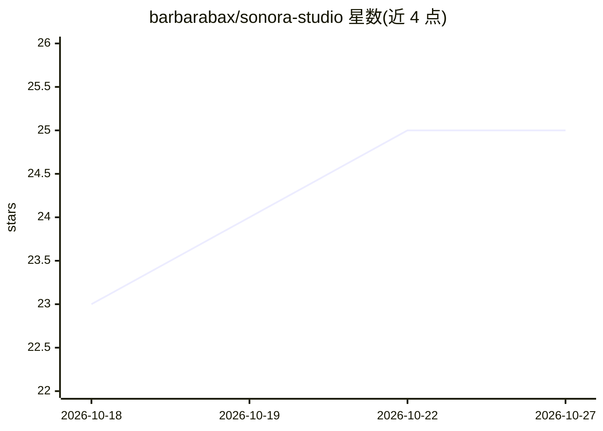

# barbarabax/sonora-studio

⭐ 25 · JavaScript · MIT · 推送 2026-10-13 · [GitHub](https://github.com/barbarabax/sonora-studio) · [官网](https://barichord.com) · 个人维护

**本地优先的 ACE-Step 1.5 AI 音乐创作工作台**

围绕 ComfyUI 与 ACE-Step 1.5 构建的音乐创作界面：提供提示词与歌词工作室、歌曲库、编辑与分轨工具、音频分析与母带工作区、可选 RunPod LoRA 训练器。本体不运行模型，需自备 ComfyUI（本机 GPU）或租用 RunPod/Vast.ai 实例执行生成；可自动检查并下载约 19.9 GB 模型文件（校验 SHA-256）。可选接入 OpenAI API 以解锁提示词润色、写词、母带建议等功能，无 key 仍可生成音乐。以 Node.js 应用形式本地运行。

## 筛选速览

| 维度 | 判定 | 备注 |
|---|---|---|
| AI 角色 | `ai-native` | 本体是模型或模型工具 |
| 许可风险 | `permissive` | MIT |
| 部署形态 | `desktop` | 安装包/桌面程序 |
| 模型依赖 | — | README 未给出锁定关系 |
| 硬件要求 | `gpu-8g` | |
| 安装摩擦 | `medium` | 含编译或系统依赖之一 |
| 成熟度 | — | 结构信号不足 |

## 能力要点

- 提示词/歌词工作室、歌曲库、编辑、分轨与母带工具
- 自动检查并下载 ACE-Step 1.5 模型文件（SHA-256 校验、断点续传）
- 三种生成后端：本机 ComfyUI / RunPod Serverless / Vast.ai SSH 隧道
- API 密钥 AES-256-GCM 本地加密，仅监听 loopback

## 适用场景

- 用自然语言风格提示与歌词生成歌曲
- 在本地 GPU 上管理并生成 AI 音乐，避免云端上传
- 无本地 GPU 时通过 RunPod/Vast.ai 租用算力生成

## 场景标签

 · 领域:AI 音乐创作工具

## 证据(README 行号)

> L3: Sonora Studio is a local-first music creation workspace built around ComfyUI and ACE-Step 1.5. It includes a music p
> L19: Sonora Studio is the control room, not a one-click installer. It needs a separate machine that actually runs the AC

## 星数曲线

2026-10-18 23 → 2026-10-27 25（+2）

---
*卡片 v1 · prompt 1.4 · 生成 2026-10-27 · 置信度 high · 依据 README sha `f9f7134c03f9` · [字段定义](../../DATASET.md)*
