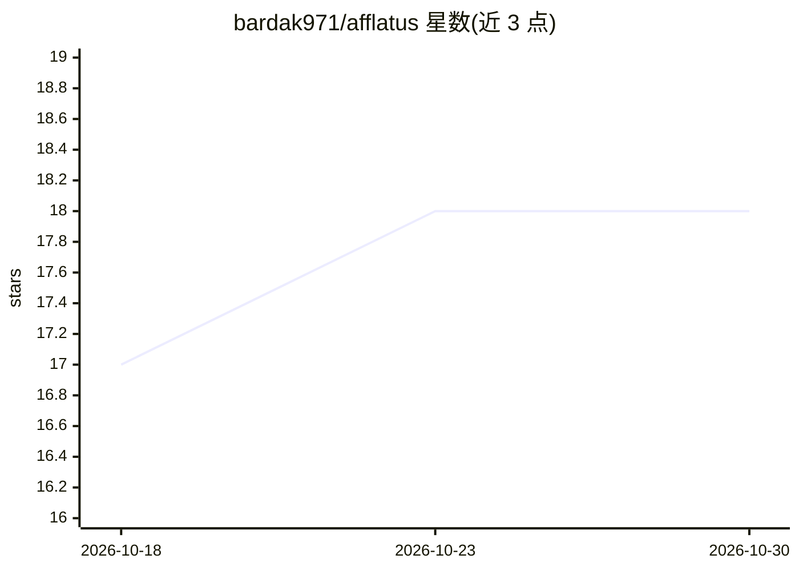

# bardak971/afflatus

⭐ 18 · TypeScript · AGPL-3.0 · 推送 2026-10-29 · [GitHub](https://github.com/bardak971/afflatus) · 个人维护

**自托管的图片/视频生成工作室，运行在自己的 ComfyUI 之上**

面向在自有 GPU 或租用算力上做生成式图片与视频的用户：保留 ComfyUI、模型与节点包负责渲染，Afflatus 提供外围工作室——保存每次渲染及其设置的资料库、每个模型一个表单（SDXL/FLUX/Krea 2/MiniMax H3/LTX/Wan 等）、把片段剪成影片的时间线，以及把任务发给最先完成的 GPU 的队列。支持从 OpenAI 风格端点（LM Studio、Ollama、llama.cpp）读取的提示词设计器、模型下载管理与 RunPod 账单拆分。以 AGPL-3.0 发布，提供 Docker 镜像。

## 筛选速览

| 维度 | 判定 | 备注 |
|---|---|---|
| AI 角色 | `ai-native` | 本体是模型或模型工具 |
| 许可风险 | `dual` | AGPL-3.0 |
| 部署形态 | `desktop` | 安装包/桌面程序 |
| 模型依赖 | local-ok | 支持本地模型 |
| 硬件要求 | — | 无带数字的原话,不猜 |
| 安装摩擦 | `low` | 无编译、无系统依赖或容器化 |
| 成熟度 | — | 结构信号不足 |

## 能力要点

- 每个模型一个表单，覆盖 SDXL、FLUX、Krea 2、MiniMax H3、LTX、Wan 等
- 时间线剪辑：多模型片段衔接、Regenerate 区间重生成、takes 管理与导出到剪辑软件
- 多机队列按完成速度分发任务，含成本核算与 RunPod 账单拆分
- MCP 接口允许 Claude Code/Claude Desktop 等 MCP 客户端驱动整个工作室，带作用域与限额的 token

## 适用场景

- 在自己 PC 和租用 GPU 上生成并管理图片与视频作品
- 把多模型生成的片段剪成一部影片并导出到专业剪辑软件
- 让 AI 助手经 MCP 在工作室内代为操作并等待人工批准

## 场景标签

`图像生成` `视频生成` · 领域:内容生成

## 证据(README 行号)

> L3:  ComfyUI's models, without living in the graph.
> L15: You keep ComfyUI, your models and your node packs; they do all the rendering. Afflatus is the studio around them: a

## 星数曲线

2026-10-18 17 → 2026-10-30 18（+1）

---
*卡片 v1 · prompt 1.4 · 生成 2026-10-29 · 置信度 mid · 依据 README sha `270112d1b31a` · [字段定义](../../DATASET.md)*
