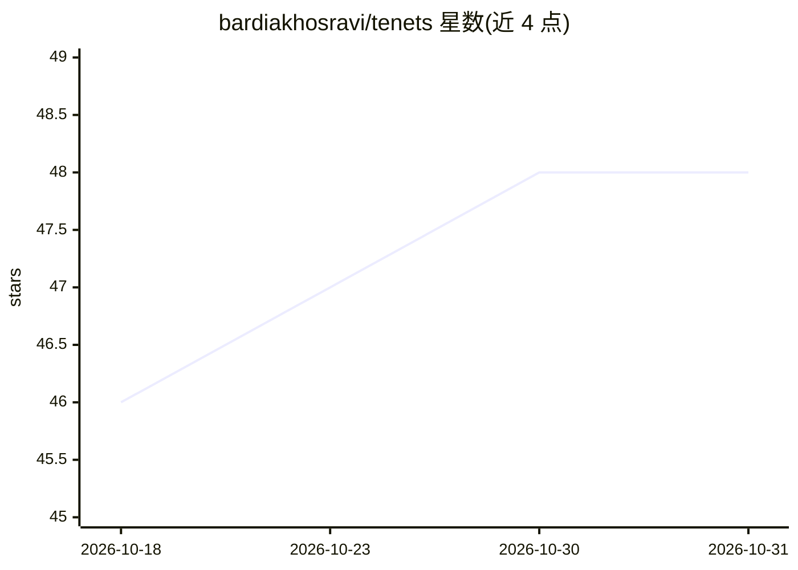

# bardiakhosravi/tenets

⭐ 48 · JavaScript · MIT · 推送 2026-10-05 · [GitHub](https://github.com/bardiakhosravi/tenets) · [官网](https://www.npmjs.com/package/tenets) · 个人维护

**给 AI 编码代理注入 DDD/六边形架构规范的 CLI 工具**

面向使用 Claude Code、Cursor、Augment、GitHub Copilot 等 AI 编码代理构建后端服务的团队：通过 npx tenets init 检测仓库并在各代理的规则/指令文件中安装版本化、仓库本地的架构守则，同一套规则贯穿代码生成、架构审查（/tenets-review-architecture，输出文件、严重级、稳定规则 ID 与整改建议）与解释（tenets explain 离线查询）。提供 core/pragmatic/strict 三档配置档，知识库当前聚焦 Python 后端；确定性源码分析与 CI 强制属于规划中的功能。默认安全策略含 dry-run、所有权标记与卸载隔离。

## 筛选速览

| 维度 | 判定 | 备注 |
|---|---|---|
| AI 角色 | `ai-ecosystem` | LLM/agent 周边工具 |
| 许可风险 | `permissive` | MIT |
| 部署形态 | `library` | 以包/库形式分发 |
| 模型依赖 | — | README 未给出锁定关系 |
| 硬件要求 | — | 无带数字的原话,不猜 |
| 安装摩擦 | `medium` | 含编译或系统依赖之一 |
| 成熟度 | — | 结构信号不足 |

## 能力要点

- 向 5 种编码代理及通用 AGENTS.md 安装统一版本化架构规则
- 架构审查输出文件、严重级、稳定规则 ID 与整改建议
- tenets explain 离线返回规则的依据、正误示例与整改方案
- dry-run、所有权标记、uninstall 隔离等安全默认机制

## 适用场景

- 让 AI 代理按 DDD/六边形架构边界生成后端代码
- 对已有服务做边界违规审查并获取带规则 ID 的整改建议
- 团队以 core/pragmatic/strict 档位统一架构标准

## 场景标签

`代码审查` · 领域:编码与开发

## 证据(README 行号)

> L3: **Architecture guardrails for AI coding agents building backend services with
> L6: Tenets installs versioned, repository-local guidance for Claude Code, Cursor,

## 星数曲线

2026-10-18 46 → 2026-10-31 48（+2）

---
*卡片 v1 · prompt 1.4 · 生成 2026-10-25 · 置信度 high · 依据 README sha `d45e2c512898` · [字段定义](../../DATASET.md)*
