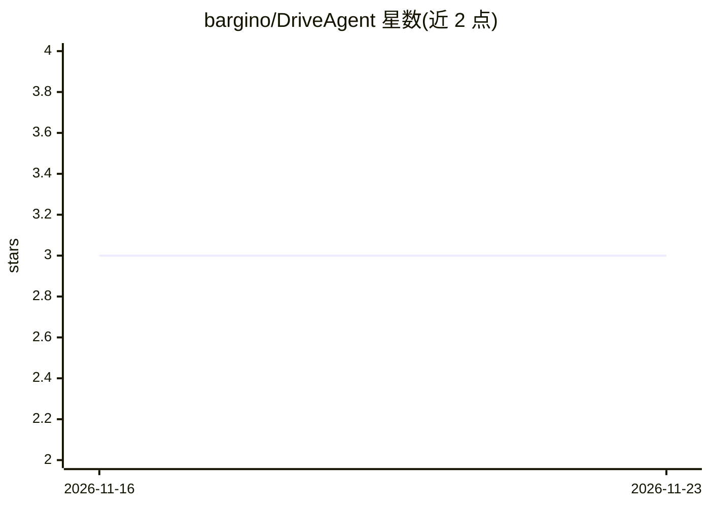

# bargino/DriveAgent

⭐ 3 · Python · 推送 2026-11-13 · [GitHub](https://github.com/bargino/DriveAgent) · 个人维护 · 中文 README

**桌面网盘 AI 助手：检索、理解并受控整理百度网盘文件**

面向网盘用户的桌面 AI agent：将文件检索、原文理解、批量整理与上传下载串成可追踪任务，模型负责理解与规划，权限审批、计划哈希核验、SQLite 状态持久化与回执对账由程序承担。技术栈为 Electron + Python/AgentScope + Go Provider，单智能体加确定性业务流程。当前为 Windows 优先的源码开发版 0.3.0，仅支持百度网盘，仓库未授予开源许可证，公开用于作品展示与代码阅读。

## 筛选速览

| 维度 | 判定 | 备注 |
|---|---|---|
| AI 角色 | `ai-native` | 本体是模型或模型工具 |
| 许可风险 | `none` | — |
| 部署形态 | `None` |  |
| 模型依赖 | — | README 未给出锁定关系 |
| 硬件要求 | — | 无带数字的原话,不猜 |
| 安装摩擦 | `low` | 无编译、无系统依赖或容器化 |
| 成熟度 | `idea` | |

## 能力要点

- 受控行动机制：审批绑定计划哈希，执行前复核防止方案偏离
- 恢复与幂等：SQLite 持久化状态，沿用 operation_id 对账，未确认写入标记 unknown
- 检索支持文件名、正文、语义、图片画面与 OCR，读取 PDF/Word/表格/图片/视频帧
- 自动化验证：Python 330 项测试、Node 206 项测试与 Go vet

## 适用场景

- 文件名记不清时用语义或 OCR 在网盘中查找资料
- 批量整理网盘文件，每步经审批并核对执行回执
- 中断任务后恢复，核对中断时的操作结果

## 场景标签

`AI 助手` · 领域:对话与助手

## 证据(README 行号)

> L5: Desktop AI agent for cloud-drive search, document understanding and controlled file operations.
> L15: 项目采用 **Electron + Python / AgentScope + Go Provider**。模型负责理解、规划与工具选择；权限、审批、路径检查、持久化、调用预算和完成核验由程序承担。当前是 Windows 优先的源
> L96: 当前连接百度网盘和用户授权的本地文件夹；其他网盘、自建 RAG 和本地全量内容索引尚未实现。云端语义 / OCR 检索依赖远端已有处理结果，提交解析不代表索引完成。视频只读取指定画面，不转写音频。真实网盘接口的可用性取决于账号、远

## 星数曲线

2026-11-16 3 → 2026-11-23 3（+0）

---
*卡片 v1 · prompt 1.4 · 生成 2026-11-22 · 置信度 high · 依据 README sha `e4bdeee27148` · [字段定义](../../DATASET.md)*
