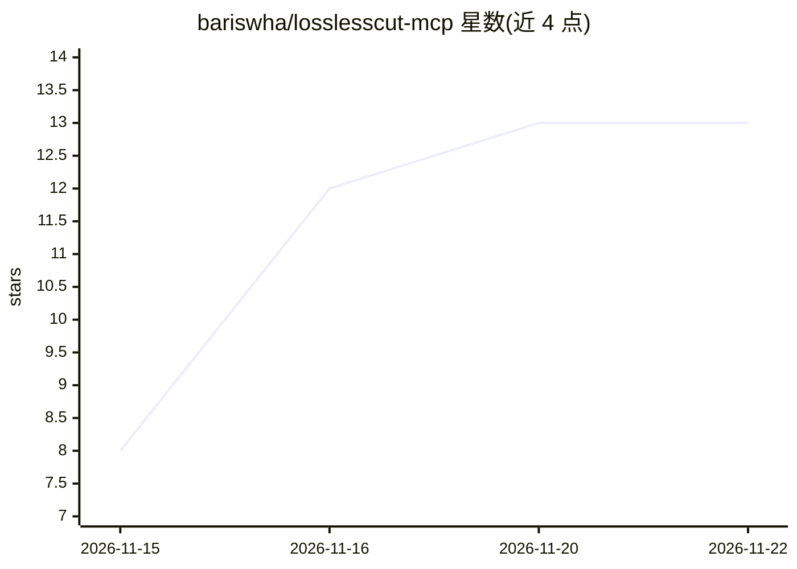

# bariswha/losslesscut-mcp

⭐ 13 · JavaScript · MIT · 推送 2026-11-12 · [GitHub](https://github.com/bariswha/losslesscut-mcp) · [官网](https://github.com/bariswha/losslesscut-mcp) · 个人维护

**MCP server：让 Claude 用 FFmpeg 看视频并用 LosslessCut 无损剪切**

以 stdio MCP server 形式运行的 Node.js 程序：通过 FFmpeg/FFprobe 在本地分析媒体（帧网格、场景切换、静音、黑场、响度、关键帧），并通过 LosslessCut 3.70+ 的本地 HTTP API 控制打开文件、加载片段、导出等操作，剪切本身由 LosslessCut 无重编码完成。面向使用 Claude Desktop/Claude Code 或其他支持 stdio 的 MCP 客户端的用户。限制包括 HTTP API 无读取回传、无错误反馈、导出可能吸附到关键帧。

## 筛选速览

| 维度 | 判定 | 备注 |
|---|---|---|
| AI 角色 | `ai-ecosystem` | LLM/agent 周边工具 |
| 许可风险 | `permissive` | MIT |
| 部署形态 | `desktop` | 安装包/桌面程序 |
| 模型依赖 | locked-api |  |
| 硬件要求 | — | 无带数字的原话,不猜 |
| 安装摩擦 | `medium` | 含编译或系统依赖之一 |
| 成熟度 | — | 结构信号不足 |

## 能力要点

- 本地 FFmpeg 分析工具：contact_sheet、detect_scenes、detect_silence、audio_levels 等
- 通过 LosslessCut HTTP API 控制 135 个白名单键盘动作
- 安全措施：仅 127.0.0.1 通信、路径校验、动作白名单
- 支持关闭帧图像发送（--no-frames）与按名禁用工具

## 适用场景

- 让 AI 助手分析视频场景切换并自动加载片段导出
- 剪切视频中的静音停顿并导出为单个文件
- 定位视频最响 moments 并围绕其生成片段

## 场景标签

`图像视频处理` · 领域:感知与多模态

## 证据(README 行号)

> L3: **Let Claude and other AI assistants see your videos and cut them with LosslessCut.**
> L5: An MCP server that looks at your media with FFmpeg (frames, scenes, silence, loudness, keyframes)
> L54: - An MCP client: Claude Desktop, Claude Code, or any other client that supports stdio servers

## 星数曲线

2026-11-15 8 → 2026-11-22 13（+5）

---
*卡片 v1 · prompt 1.4 · 生成 2026-11-18 · 置信度 high · 依据 README sha `c8424ea349d5` · [字段定义](../../DATASET.md)*
