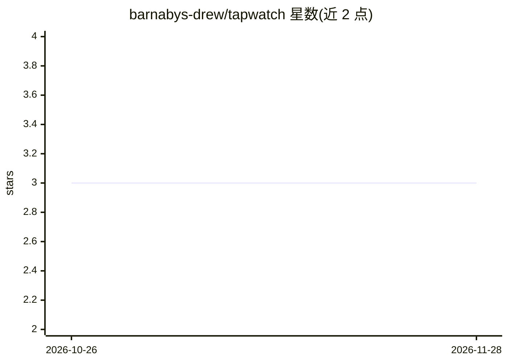

# barnabys-drew/tapwatch

⭐ 3 · Python · MIT · 推送 2026-11-15 · [GitHub](https://github.com/barnabys-drew/tapwatch) · 个人维护

**家庭/小型办公室网络安全监控：镜像口 Zeek + AI 分诊**

在镜像口运行 Zeek、读取路由器 syslog、可选 osquery 端点代理的本地优先 NSM：47 种用纯 Python 编写的检测用例覆盖新设备、beaconing、DNS 隧道、暴露服务、勒索蠕虫形态等；代码证明的事实为可选的小模型（Jev）分诊设定不可越过的上下限，无 API key 时仅按规则运行。案件台为无 JavaScript 的服务端 HTML，支持自检重放、可回滚更新与状态迁移，仅告警等文字外发。

## 筛选速览

| 维度 | 判定 | 备注 |
|---|---|---|
| AI 角色 | `ai-enhanced` | 去掉 AI 部分产品仍成立 |
| 许可风险 | `permissive` | MIT |
| 部署形态 | `self-host` | docker 或自建部署 |
| 模型依赖 | — | README 未给出锁定关系 |
| 硬件要求 | — | 无带数字的原话,不猜 |
| 安装摩擦 | `low` | 无编译、无系统依赖或容器化 |
| 成熟度 | — | 结构信号不足 |

## 能力要点

- 47 个案件类型（22 网络、5 长周期、20 主机），每个为带测试与规格说明的纯 Python 检测器
- 护栏化 AI 分诊：代码事实设定模型不可越过的上下限，0.75 置信度才自行告警
- tapwatch selfcheck 重放 37 种攻击与误报形态并报告检出率
- 可回滚更新与传感器状态迁移（cases、notes、学习基线）

## 适用场景

- 为没有 SOC 的家庭/小办公室提供无人值守的网络告警
- 识别家用 IoT 设备的异常外联与 DNS 隧道
- 区分自己编码 Agent 的流量与被注入/劫持的 Agent 流量

## 场景标签

`网络安全` · 领域:学习与行业

## 证据(README 行号)

> L9: own syslog, optional endpoint agents, readable detection code, and AI triage that can't override
> L19: case says whether the owner's coding agent was behind it. An optional small AI model
> L21: reach your phone. One small box runs it all, with no SIEM; nothing leaves but your

## 星数曲线

2026-10-26 3 → 2026-11-28 3（+0）

---
*卡片 v1 · prompt 1.4 · 生成 2026-11-22 · 置信度 mid · 依据 README sha `4e16ad9cd70f` · [字段定义](../../DATASET.md)*
