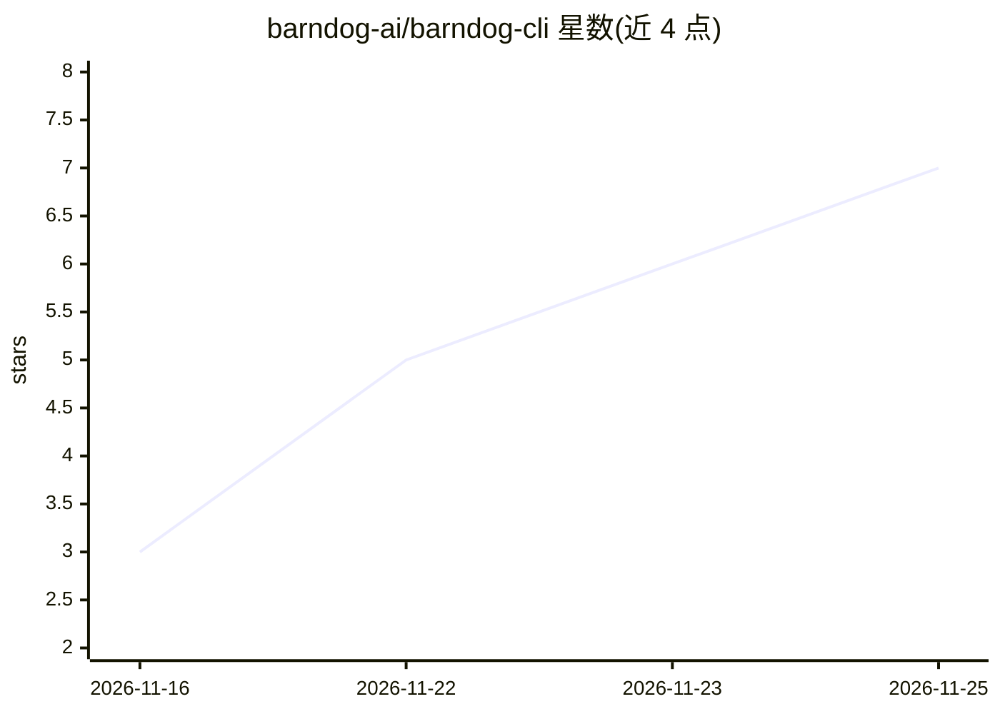

# barndog-ai/barndog-cli

⭐ 7 · TypeScript · MIT · 推送 2026-11-23 · [GitHub](https://github.com/barndog-ai/barndog-cli) · [官网](https://barndog.dev) · 组织维护

**跨 AI 编码工具统一安装与同步 Skills/MCP/Hooks 的 CLI**

barndog 是 BarnDog 的命令行工具，把 Skills、MCP 服务器、Hooks 和知识一次性写入 Claude Code、Codex、Cursor、OpenCode 等编码 agent 的原生配置位置，并随会话启动自动同步更新。支持三种工作区：本地文件夹（个人）、Git 仓库（团队自管数据）和 BarnDog Cloud（目录管理与按团队审批）。资产以代码方式修改、评审后分发；只改动自身安装的内容，变更先记日志再应用。需 Node.js 24+，支持 macOS/Linux/Windows。

## 筛选速览

| 维度 | 判定 | 备注 |
|---|---|---|
| AI 角色 | `ai-ecosystem` | LLM/agent 周边工具 |
| 许可风险 | `permissive` | MIT |
| 部署形态 | `library` | 以包/库形式分发 |
| 模型依赖 | — | README 未给出锁定关系 |
| 硬件要求 | — | 无带数字的原话,不猜 |
| 安装摩擦 | `low` | 无编译、无系统依赖或容器化 |
| 成熟度 | — | 结构信号不足 |

## 能力要点

- 一份配置以各工具原生格式写入多个编码 agent（Claude Code/Codex/Cursor/OpenCode）
- 三种工作区模式：本地文件夹、Git 仓库、BarnDog Cloud（带目录与团队审批）
- 不接管手工添加的 skill/MCP/hook，变更日志化，中断同步可安全续跑
- skills add/search/pull/diff/push 的资产修改与评审流程

## 适用场景

- 团队统一维护一套 agent 技能与 MCP 配置并分发到成员
- 在多个编码 agent 间保持同一套 Skills 与 Hooks 一致
- 通过评审流程（pull request 或 Suggested Change）迭代共享资产

## 场景标签

 · 领域:AI 编码工具基础设施/配置管理

## 证据(README 行号)

> L5: `barndog` is the command-line tool for BarnDog. It installs Skills, MCP servers, Hooks, and knowledge into the codin
> L7: Currently supported harnesses:
> L44: 3. **Sync.** `barndog sync` writes everything into each tool's native location. It runs again automatically when a 

## 星数曲线

2026-11-16 3 → 2026-11-25 7（+4）

---
*卡片 v1 · prompt 1.4 · 生成 2026-11-22 · 置信度 high · 依据 README sha `67e6459d583d` · [字段定义](../../DATASET.md)*
